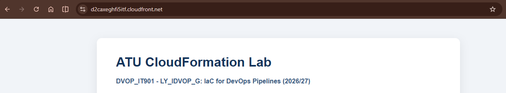
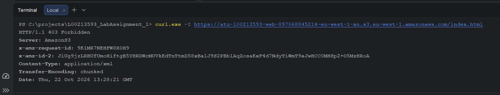
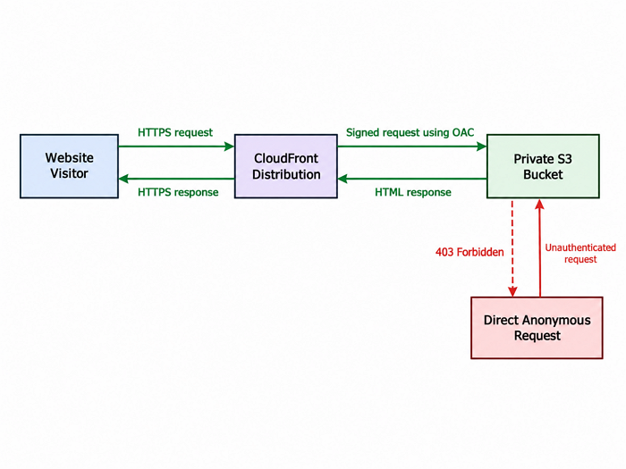

# ATU CloudFormation Lab

[](https://d2caxeghfi5itf.cloudfront.net/)

**Atlantic Technological University (ATU)**

**Programme:** Postgraduate Diploma in Computing in DevOps
**Module:** Infrastructure as Code for DevOps Pipelines

**Lecturer:** Ruth Lennon  
**Student:** Maksym Voronianskyi  
**Student Number:** L00213593  
**Academic Year:** 2026/2027

---

## 1. Project Overview

This project is part of the CloudFormation Lab assignment at the Atlantic Technological University (ATU).

The main objective is to design, deploy and manage AWS infrastructure using AWS CloudFormation
and Infrastructure as Code (IaC) principles. AWS CloudFormation uses templates
to define and manage AWS resources as stacks [[1]](#ref-1).

The project will be developed in small stages. Each stage will introduce
new features, improve the infrastructure and document the changes.

Git and GitHub will be used to manage source code, track changes and organise
development through branches and Pull Requests.
This follows AWS guidance on version control and code reviews
for infrastructure templates [[2]](#ref-2).

## 2. Project Objectives

The project consists of two main parts.

### Part A(a) — Implementation Status

The static website infrastructure has been deployed and verified using AWS CloudFormation.

| Component              | Implementation                                            | Status    |
|------------------------|-----------------------------------------------------------|-----------|
| Amazon S3              | Private bucket provisioned using CloudFormation           | Completed |
| S3 Security            | Block Public Access, Bucket Policy and disabled ACLs      | Completed |
| Amazon CloudFront      | HTTPS delivery using Origin Access Control (OAC)          | Completed |
| Static Website         | HTML page deployed and accessible through CloudFront      | Completed |
| S3 Encryption          | Server-side encryption using SSE-S3 (AES256)              | Completed |
| S3 Versioning          | Previous object versions are preserved                    | Completed |
| S3 Lifecycle           | Noncurrent versions expire after 30 days                  | Completed |
| IAM Security           | Permissions restricted using least privilege              | Completed |
| Testing and Validation | CloudFormation, AWS CLI and access control tests          | Completed |
| Documentation          | README, screenshots, architecture diagram and Git history | Completed |

**Deployment Status:** Completed and verified.
**CloudFormation Stack:** `ATU-Static-Website`
**AWS Region:** `eu-west-1`

### Part A(b) — Three-Tier Architecture

**Status:** In progress. The API Gateway HTTP API, Java 21 Lambda application and Amazon DynamoDB table are deployed and
tested end to end. The web user interface has been integrated with the API.

| Tier             | Component                                             | Current status                              |
|------------------|-------------------------------------------------------|---------------------------------------------|
| Web Tier         | Static HTML website delivered using S3 and CloudFront | Deployed; API integration tested            |
| Application Tier | API Gateway HTTP API and Java Lambda                  | Deployed; GET and IAM-protected POST tested |
| Database Tier    | Amazon DynamoDB messages table                        | Deployed; write and read verified           |

The application supports a public `GET /message` endpoint and an `AWS_IAM`-protected `POST /message` endpoint. A signed
POST request returned `201 Created` and a subsequent GET returned the same saved record. Both application endpoints are
managed through the `ATU-Three-Tier` CloudFormation stack. The static website is managed through the separate
`ATU-Static-Website` stack.

The infrastructure is defined in AWS CloudFormation templates. Some deployment-user IAM bootstrap permissions were
configured manually and still require security remediation; therefore the deployment process is not yet fully managed as
IaC.

## 3. Development Approach

The project follows an incremental development approach.

Each stage will include:

1. Creating a new Git feature branch.
2. Implementing a small change.
3. Testing the changes.
4. Documenting the implementation and design decisions.
5. Creating a Pull Request.
6. Reviewing and merging the changes into the main branch.

This approach will help maintain a clear development
history and make each improvement easier to understand.
It is consistent with AWS CloudFormation best practices
for version control, code reviews and validation [[2]](#ref-2).

## 4. Project Structure

The initial project structure is:

```text
L00213593_LabAssignment_1/
├── infrastructure/
├── web/
├── docs/
│   └── CODE_OF_CONDUCT.md
├── README.md
└── .gitignore
```

Additional files and directories will be introduced as the project develops.

## 5. Development Progress

### Iteration 0 — Project Initialisation

**Objective:** Prepare the repository and document the project objectives.

**Planned activities:**

- Initialise the Git repository.
- Create the initial project structure.
- Add the README file.
- Configure `.gitignore`.

**Next step:** Create the first static HTML page.

### Iteration 1 — Static HTML Website

**Objective:** Create a basic HTML page for the static website.

**Implementation:**

- Created `web/index.html`.
- Added the student name and student number.
- Added a project overview and infrastructure section.
- Used semantic HTML elements to organise the page.

**Design Decision:**

I decided to use plain HTML without a frontend framework.
The first part of the assignment requires a static website, so a simple HTML page is sufficient.

This approach has fewer dependencies and does not require a build process.
However, it provides fewer features than a modern frontend framework.

AWS documentation confirms that Amazon S3 can store static website content, including HTML files [[3]](#ref-3).

**Testing:**

The page was opened locally in a web browser. The project title, student name, student number and other content were
displayed correctly.

**Next Step:**

Create a CloudFormation template to provision an Amazon S3 bucket.

### Iteration 2 — S3 Infrastructure with CloudFormation

**Objective:** Define, deploy and verify a private S3 bucket using an AWS CloudFormation template.

**Implementation:**

- Created `infrastructure/static-website.yaml` with `AWS::S3::Bucket`.
- Enabled Block Public Access and `BucketOwnerEnforced` to disable ACL-based access management.
- Configured SSE-S3 encryption (`AES256`), resource tags and CloudFormation outputs.
  SSE-S3 uses Amazon S3 managed keys [[7]](#ref-7).
- Used a recognisable bucket prefix with an account-regional namespace.

**Access Control Decision:**

S3 supports Access Control Lists (ACLs) and resource policies. For this project,
ACLs are disabled using `BucketOwnerEnforced`. Permissions are managed through IAM
and bucket policies instead [[4]](#ref-4). The bucket remains private; CloudFront
will be configured later to serve the website publicly.

`BlockPublicAcls` prevents new public ACLs, while `IgnorePublicAcls` ignores existing
public ACL permissions. These overlap with disabled ACLs, but are retained as an
additional safeguard if the ownership configuration changes. `BlockPublicPolicy` blocks new public bucket policies (not
all bucket policies),and `RestrictPublicBuckets` limits access when a bucket policy is public [[5]](#ref-5).

**Bucket Naming Decision:**

I decided to use a custom S3 bucket name prefix with the account-regional namespace instead of a fully autogenerated
name.

This makes the bucket easier to identify and helps avoid naming conflicts with buckets belonging to other AWS accounts.

CloudFormation can generate the account and Region suffix automatically using the `BucketNamePrefix`
property [[6]](#ref-6).

**Alternative:** Use an automatically generated bucket name or define a complete name using `BucketName` and `!Sub`.

**Limitation:** The bucket prefix must follow Amazon S3 naming rules. Changes to bucket naming properties may require
resource replacement.

#### AWS CLI Configuration and Troubleshooting

**Objective:** Configure secure AWS CLI access and validate the CloudFormation template.

**1. AWS CLI authentication**

I installed AWS CLI v2 and attempted to validate the CloudFormation template. The first attempt failed with the
following error:

```text
NoCredentials: Unable to locate credentials
```

The CLI was not authenticated with AWS.

I initially signed in using my AWS root account. However, I decided to create a separate IAM user for development to
avoid using root credentials for daily tasks.

I created:

- IAM user: `atu-devops-lab`
- IAM group: `ATU-DevOps-Lab-Developers`
- MFA authentication for additional account security
- Local AWS CLI profile: `atu-lab`

I used browser-based authentication to obtain temporary credentials without creating permanent access keys.

```powershell
aws login --profile atu-lab --region eu-west-1
```

**2. Identity verification**

I verified the authenticated user with AWS Security Token Service (STS):

```powershell
aws sts get-caller-identity --profile atu-lab
```

**Result:** AWS confirmed that the request was made by the IAM user `atu-devops-lab`, rather than the root user.

**3. CloudFormation permission error**

The next attempt to validate the template failed:

```text
AccessDenied: not authorized to perform:
cloudformation:ValidateTemplate
```

The IAM user had permission to sign in, but did not have permission to validate CloudFormation templates.

To resolve this issue, I created a customer-managed IAM policy called `ATU-CloudFormation-Lab-Policy`.

The policy initially allowed only one action:

```json
{
  "Effect": "Allow",
  "Action": "cloudformation:ValidateTemplate",
  "Resource": "*"
}
```

I attached this policy to the `ATU-DevOps-Lab-Developers` group.

This follows the principle of least privilege, where permissions are granted only when required [[8]](#ref-8).

**4. Successful template validation**

I repeated the validation using the configured AWS profile:

```powershell
aws cloudformation validate-template `
  --template-body file://infrastructure/static-website.yaml `
  --region eu-west-1 `
  --profile atu-lab
```

**Result: Passed**

CloudFormation returned the template description and an empty parameters list:

```json
{
  "Parameters": [],
  "Description": "ATU CloudFormation Lab - Part A(a). Creates a private S3 bucket for static website content.\n"
}
```

This confirmed that AWS CloudFormation could read and parse the template successfully. It did not confirm that the
infrastructure had been deployed.

**Lessons Learned:**

- AWS CLI authentication and IAM permissions are separate processes.
- An authenticated user does not automatically have access to AWS services.
- Named CLI profiles make it easier to select the correct AWS identity.
- IAM permissions can be added gradually instead of granting full administrator access.
- CloudFormation template validation should be performed before deployment.

AWS CLI configuration and authentication are documented in the official AWS CLI User Guide [[9]](#ref-9).

#### Extending IAM Permissions for Deployment

**Objective:** Allow the IAM user to deploy and manage the S3 infrastructure using CloudFormation.

Initially, the IAM policy allowed only `cloudformation:ValidateTemplate`. This was sufficient to validate the YAML
template, but not to create AWS resources.

Before deployment, I extended the customer-managed policy `ATU-CloudFormation-Lab-Policy`.

The permissions were organised into three groups:

| Permission Group    | Purpose                                                                          |
|---------------------|----------------------------------------------------------------------------------|
| `ValidateTemplates` | Validate CloudFormation templates before deployment.                             |
| `ManageLabStack`    | Create, update, inspect and delete the CloudFormation stack and its change sets. |
| `ManageLabS3Bucket` | Create and configure the S3 bucket used by the website.                          |

**Design Decision:**

I decided to extend the existing IAM policy rather than grant `AdministratorAccess`.

The CloudFormation permissions are restricted to the `ATU-Static-Website` stack in the `eu-west-1` Region and its
associated change sets.

The S3 permissions are restricted to bucket names beginning with `atu-l00213593-web-`.

This follows the principle of least privilege and reduces the scope of permissions available to the IAM
user [[8]](#ref-8).

**Why are Change Sets required?**

The AWS CLI `cloudformation deploy` command uses change sets to prepare and execute infrastructure changes. They allow
CloudFormation to identify which resources will be created or updated.

**Limitation:**

The initial permissions may need further adjustment during deployment. Any additional permissions will be reviewed and
documented rather than granting unrestricted access.

**Validation:**

IAM policy update: **Completed**.

CloudFormation stack deployment: **Passed** (`CREATE_COMPLETE`).

The initial permission set was sufficient for this S3-only deployment.

AWS explains CloudFormation actions, resources and permissions in its IAM access
control documentation [[10]](#ref-10).

#### Deployment and AWS CLI Verification

**Deployment:** I deployed the CloudFormation template using `aws cloudformation deploy`.
AWS CLI uses a change set to create or update the stack [[11]](#ref-11).

```powershell
aws cloudformation deploy `
  --template-file infrastructure/static-website.yaml `
  --stack-name ATU-Static-Website `
  --region eu-west-1 `
  --profile atu-lab
```

**Result:** `Successfully created/updated stack - ATU-Static-Website`.

**Stack status and outputs:** The `describe-stacks` command returns information about
the specified stack, including its status and output values [[12]](#ref-12).

```powershell
aws cloudformation describe-stacks `
  --stack-name ATU-Static-Website `
  --region eu-west-1 `
  --profile atu-lab `
  --query "Stacks[0].StackStatus" `
  --output text
```

**Result:** `CREATE_COMPLETE`.

Using the same command with `--query "Stacks[0].Outputs" --output table`
returned `WebsiteBucketName` and `WebsiteBucketArn`. The generated bucket name
was `atu-l00213593-web-897068845214-eu-west-1-an`.

**Security and configuration checks:** I checked the deployed S3 configuration
using AWS CLI commands documented in the official command reference:

| CLI command                                               | What it verifies                         | Actual result                 |
|-----------------------------------------------------------|------------------------------------------|-------------------------------|
| `aws s3api get-public-access-block` [[13]](#ref-13)       | Four settings that prevent public access | All four set to `true`        |
| `aws s3api get-bucket-encryption` [[14]](#ref-14)         | Default server-side encryption           | `AES256` (SSE-S3)             |
| `aws s3api get-bucket-ownership-controls` [[15]](#ref-15) | Object ownership and ACL configuration   | `BucketOwnerEnforced`         |
| `aws s3api get-bucket-tagging` [[16]](#ref-16)            | Resource metadata                        | All four project tags present |

Each S3 command was run with `--bucket atu-l00213593-web-897068845214-eu-west-1-an`,
`--region eu-west-1` and `--profile atu-lab`.

The tagging response also included three automatically added CloudFormation tags:
`aws:cloudformation:stack-name`, `aws:cloudformation:stack-id` and
`aws:cloudformation:logical-id`.

**Conclusion:** The S3 resource was created and its access restrictions,
encryption, object ownership and tags were confirmed using AWS CLI.
At the end of Iteration 2, the bucket was private and the website was not yet publicly accessible.
Iteration 3 added CloudFront delivery and controlled access to S3.

### Iteration 3 — CloudFront Delivery and Private S3 Access

**Implementation**

Added `AWS::CloudFront::OriginAccessControl` to the CloudFormation template.

**Design Decision**

I selected Origin Access Control (OAC) instead of the older Origin Access Identity (OAI).
OAC allows CloudFront to send authenticated requests to a private S3 bucket using AWS Signature Version
4 [[17]](#ref-17).

**Validation**

The CloudFormation template was checked using `aws cloudformation validate-template`.

#### CloudFront Distribution

**Implementation**

Added `AWS::CloudFront::Distribution` to deliver the static website through HTTPS.
The distribution uses the private S3 bucket as its origin and connects to the previously configured OAC.

**Design Decisions**

I selected `PriceClass_100` to limit CloudFront delivery locations mainly to North America and Europe and help control
costs [[18]](#ref-18).
I configured `redirect-to-https` to redirect HTTP requests to HTTPS.
Because OAC is used instead of the older OAI mechanism, `OriginAccessIdentity` is set to an empty string, as described
in AWS documentation [[19]](#ref-19).
I selected the AWS managed `CachingOptimized` cache policy to reduce repeated requests to S3. Its policy ID is provided
in the official AWS documentation [[20]](#ref-20).

#### S3 Bucket Policy for CloudFront

**Implementation**

Added `AWS::S3::BucketPolicy` to allow CloudFront to read objects from the private S3 bucket.

**Design Decision**

I decided to keep the S3 bucket private and allow access only through the configured CloudFront distribution.
The policy grants `s3:GetObject` permission to the CloudFront service. The `AWS:SourceArn` condition restricts access to
the specific distribution created by this project.
This follows the AWS recommendation for using Origin Access Control with a private S3 origin [[21]](#ref-21).

**Validation**

The updated CloudFormation template was successfully checked using `aws cloudformation validate-template`.

The CloudFront distribution and bucket policy were deployed successfully (stack status: `UPDATE_COMPLETE`).

**CloudFront Distribution ARN**

A CloudFront distribution defines how content is delivered from an origin, such as an S3 bucket. AWS automatically
assigns a unique Distribution ID when the resource is created.

The bucket policy uses `AWS:SourceArn` to restrict `s3:GetObject` access to this specific distribution.

The ARN follows the AWS-defined format `arn:partition:cloudfront::account-id:distribution/distribution-id`.
CloudFormation uses `!Sub` to insert the AWS partition, account ID and generated Distribution ID automatically.

This avoids hardcoding resource identifiers and ensures that the bucket policy refers to the correct CloudFront
distribution [[21]](#ref-21).

#### CloudFront Outputs

**Implementation**

Added `WebsiteURL` and `WebsiteDistributionId` to the CloudFormation outputs.

**Design Decision**

I decided to use CloudFormation outputs instead of manually copying the distribution domain name and ID from the AWS
Console.

CloudFormation returns the generated distribution domain through `${WebsiteDistribution.DomainName}` inside `!Sub` (
equivalent to `Fn::GetAtt`) and the distribution ID using `!Ref` [[22]](#ref-22).

The outputs were verified after deployment using `aws cloudformation describe-stacks`.

#### Extending IAM Permissions for CloudFront

**Objective**

Allow the `atu-devops-lab` IAM user to deploy and manage CloudFront resources using CloudFormation.

**Implementation**

Updated the existing customer-managed policy `ATU-CloudFormation-Lab-Policy`.
Added permissions for:

- Creating and managing CloudFront distributions.
- Creating and managing Origin Access Controls (OAC).
- Reading, updating and deleting the S3 bucket policy.

**Design Decision**

I extended the existing IAM policy instead of granting `AdministratorAccess`.
CloudFront management permissions are restricted to distribution and OAC resources in my AWS account where supported.
Some creation operations require `Resource: "*"`.
This approach follows the principle of least privilege [[8]](#ref-8).

**Limitation**

The IAM policy was updated manually through the AWS Console and is not currently managed by the CloudFormation template.

**Validation**

The IAM policy changes were saved successfully.
The permissions were successfully exercised during the CloudFormation deployment.

#### Static Website Deployment and S3 Permissions

**Objective**

Upload the static HTML website to the private S3 bucket and verify that it is accessible through CloudFront.

**Problem**

The first attempt to upload `web/index.html` failed:

```text
AccessDenied: not authorized to perform: s3:PutObject
because no identity-based policy allows the s3:PutObject action
```

The IAM user `atu-devops-lab` had permissions to create and configure the S3 bucket but did not have permission to
upload objects.

**Solution**

I extended the existing IAM policy `ATU-CloudFormation-Lab-Policy` by adding a separate statement named
`UploadWebsiteIndex`.

```json
{
  "Sid": "UploadWebsiteIndex",
  "Effect": "Allow",
  "Action": "s3:PutObject",
  "Resource": "arn:aws:s3:::atu-l00213593-web-897068845214-eu-west-1-an/index.html"
}
```

I decided to restrict `s3:PutObject` to the specific `index.html` object instead of allowing uploads to all objects in
the bucket.

This follows the principle of least privilege [[8]](#ref-8).

**Deployment**

After updating the IAM policy, I repeated the upload:

```powershell
aws s3 cp web/index.html `
  s3://atu-l00213593-web-897068845214-eu-west-1-an/index.html `
  --content-type "text/html" `
  --region eu-west-1 `
  --profile atu-lab
```

**Result:** The HTML file was uploaded successfully.

**CloudFormation Verification**

The `ATU-Static-Website` stack was successfully updated.
Stack status: `UPDATE_COMPLETE`.
CloudFormation returned the following outputs:

| Output                | Value                                         |
|-----------------------|-----------------------------------------------|
| WebsiteBucketName     | `atu-l00213593-web-897068845214-eu-west-1-an` |
| WebsiteDistributionId | `EV2KPMP2U0HIG`                               |
| WebsiteURL            | https://d2caxeghfi5itf.cloudfront.net         |

**Website Testing**

I opened the CloudFront URL in a web browser using HTTPS.
The website displayed correctly, including:

- Project title and module information.
- Student name and student number.
- Project overview and infrastructure information.
- Centred page layout and CSS styling.

**Result: Passed**

The static website is accessible through CloudFront over HTTPS while the S3 bucket remains private.

**Website Screenshot**

The screenshot below shows the static website successfully delivered through Amazon CloudFront over HTTPS.



#### S3 Direct Access Security Test

**Objective**

Verify that the static website is accessible through CloudFront while direct public access to the S3 bucket is denied.

**Test**

I sent an unauthenticated HTTP request directly to the S3 object:

```powershell
curl.exe -I https://atu-l00213593-web-897068845214-eu-west-1-an.s3.eu-west-1.amazonaws.com/index.html
```

**Expected Result:** `403 Forbidden`.

**Actual Result:** `403 Forbidden`.

**Conclusion**

The test confirmed that direct anonymous access to the S3 object is denied.
The website remains accessible through CloudFront over HTTPS.

This is consistent with the private S3 origin configuration and Origin Access Control (OAC) approach recommended by
AWS [[21]](#ref-21).

**Security Test Screenshot**



#### CloudFront and S3 Access Control Diagram

**Architecture Overview**

The diagram below illustrates how CloudFront provides access to the static website while direct anonymous requests to
the private S3 bucket are denied.



**Security Explanation**

CloudFront uses Origin Access Control (OAC) to sign requests to the private S3 bucket.
The bucket policy allows `s3:GetObject` only for requests from the configured CloudFront distribution, using the
`AWS:SourceArn` condition.

Direct anonymous requests are denied with `403 Forbidden`,
as confirmed by the security test [[21]](#ref-21).

### Iteration 4 — S3 Versioning

**Objective**
Enable S3 Versioning to preserve previous versions of website files.

**Implementation**
Added `VersioningConfiguration` to the `WebsiteBucket` resource in `infrastructure/static-website.yaml`.

```yaml
VersioningConfiguration:
  Status: Enabled
```

**Design Decision**
I decided to enable S3 Versioning to protect website files from accidental overwriting or deletion.
When a new version of `index.html` is uploaded, Amazon S3 retains the previous version. This makes it possible to
recover earlier website content if needed [[23]](#ref-23).

**Limitation**
Previous versions consume storage space and may increase costs. A Lifecycle rule was added in Iteration 5 to
manage older versions.

**Validation**

The CloudFormation template was successfully validated using `aws cloudformation validate-template`.

The `ATU-Static-Website` stack was successfully updated using `aws cloudformation deploy`.

S3 Versioning was verified using `aws s3api get-bucket-versioning`.

**Result: Passed**

The command returned `Status: Enabled`, confirming that S3 Versioning is enabled.

### Iteration 5 — S3 Lifecycle Management

**Objective**
Automatically remove previous versions of website files to reduce unnecessary storage costs.

**Implementation**
Added `LifecycleConfiguration` to the `WebsiteBucket` resource in `infrastructure/static-website.yaml`.

```yaml
LifecycleConfiguration:
  Rules:
    - Id: DeleteOldWebsiteVersions
      Status: Enabled
      NoncurrentVersionExpiration:
        NoncurrentDays: 30
```

**Design Decision**

I decided to keep previous versions of website files for 30 days after they become noncurrent.
S3 Lifecycle automatically removes these older versions after the retention period while preserving the current version
of `index.html`.
This helps control storage costs while allowing recently replaced files to be recovered [[24]](#ref-24).

**Limitation**
Lifecycle expiration is asynchronous. S3 may not physically remove an eligible version immediately after the retention
period.

**Validation**

The CloudFormation template was successfully validated using `aws cloudformation validate-template`.

The Lifecycle configuration was successfully deployed through CloudFormation.

I verified the configuration using `aws s3api get-bucket-lifecycle-configuration`.

**Result: Passed**

The response confirmed that the `DeleteOldWebsiteVersions` rule is enabled and configured to expire noncurrent object
versions after 30 days.

**IAM Permission Troubleshooting**

The first CloudFormation deployment failed because the IAM user `atu-devops-lab` did not have permission to perform
`s3:PutLifecycleConfiguration`. CloudFormation reported `UPDATE_FAILED` for `WebsiteBucket` and then completed the
rollback (`UPDATE_ROLLBACK_COMPLETE`).

I extended the customer-managed policy `ATU-CloudFormation-Lab-Policy` with a separate statement named
`ManageWebsiteVersioningAndLifecycle`.

The statement grants `s3:PutBucketVersioning`, `s3:GetBucketVersioning`, `s3:PutLifecycleConfiguration` and
`s3:GetLifecycleConfiguration` on the specific website bucket only.

The first retry also failed because I had not saved the IAM policy changes in the AWS Console. After saving the policy,
I repeated the CloudFormation deployment successfully.

This approach follows the principle of least privilege [[8]](#ref-8).

### Iteration 6 — Three-Tier Architecture: Java Lambda Setup

**Objective**

Prepare a Java application for the Application Tier of Part A(b).

**Implementation**

- Created the Maven project with `pom.xml` in the repository root and the handler at
  `src/main/java/ie/atu/lab/MessageHandler.java`.
- Configured the Maven Compiler Plugin to compile the application using Java 21, a runtime supported by AWS
  Lambda [[25]](#ref-25).
- Added `com.amazonaws:aws-lambda-java-core` for the `RequestHandler` interface and Lambda `Context`
  object [[26]](#ref-26).
- Added the AWS SDK for Java 2.x `software.amazon.awssdk:dynamodb` module for future database
  operations [[27]](#ref-27).
- Imported the AWS SDK BOM under Maven `dependencyManagement` to manage compatible SDK module versions without declaring
  a separate version for DynamoDB [[27]](#ref-27).
- Configured Maven Shade Plugin to package the Java code and dependencies into a single JAR for Lambda
  deployment [[28]](#ref-28) [[29]](#ref-29).
- Implemented a basic `MessageHandler` returning a JSON response. The `RequestHandler` interface, `handleRequest` method
  and `Context` logging API follow the AWS Lambda Java handler documentation [[26]](#ref-26).

**Design Decision**

I selected Java 21 and Maven for the Application Tier. I decided to use a simple Java Lambda handler instead of Spring
Boot to keep the application small and avoid unnecessary dependencies.

The AWS SDK BOM manages the versions of AWS SDK modules, while `aws-lambda-java-core` is declared separately because it
does not belong to the `software.amazon.awssdk` BOM [[27]](#ref-27).

Maven Shade Plugin creates a deployment JAR containing the application and its
dependencies [[28]](#ref-28) [[29]](#ref-29).

**Validation**

The Maven project was successfully built from the repository root using `mvn clean package`.

**Result:** `BUILD SUCCESS`. Maven Shade Plugin reported overlapping `META-INF` resources during packaging; these
warnings did not prevent the build.

**Limitation**

The Lambda function has not yet been deployed to AWS. API Gateway and DynamoDB integration will be implemented in the
next iterations.

### Iteration 7 — DynamoDB Database Tier

**Objective**
Define a DynamoDB table for storing messages in the three-tier application.

**Implementation**

- Added the `MessagesTable` resource to `infrastructure/three-tier.yaml`.
- Configured the `id` attribute as a String partition key.
- Selected `PAY_PER_REQUEST` billing mode.
- Added resource tags and a CloudFormation output for the table name.

**Design Decision**
I selected Amazon DynamoDB because it is a managed NoSQL database and does not require database server administration.
The `PAY_PER_REQUEST` billing mode was selected because the application is small and the number of requests is expected
to be low.
The table name is generated using `!Sub` and the `${AWS::StackName}` pseudo parameter instead of hardcoding the stack
name [[30]](#ref-30) [[31]](#ref-31).
The table is defined using the `AWS::DynamoDB::Table` resource [[32]](#ref-32).

**Validation**
The CloudFormation template was successfully validated using `aws cloudformation validate-template`.

**Result:** Template validation passed.

**Limitation**
The DynamoDB table has not yet been deployed. The Java Lambda integration will be implemented in a later iteration.

### Iteration 8 — Lambda Execution Role

**Objective**
Define an IAM execution role for the Java Lambda function.

**Implementation**

- Added `MessageLambdaRole` to `infrastructure/three-tier.yaml`.
- Configured a trust policy allowing AWS Lambda to assume the role.
- Attached the AWS-managed `AWSLambdaBasicExecutionRole` policy for CloudWatch logging.
- Added permissions for `dynamodb:PutItem`, `dynamodb:GetItem` and `dynamodb:Scan`.
- Restricted DynamoDB access to the `MessagesTable` ARN using `!GetAtt`.

**Design Decision**
I decided to create a separate execution role for the Java Lambda function instead of using the IAM user that deploys
the infrastructure.
The role follows the principle of least privilege by granting access only to the required DynamoDB operations and the
project table [[33]](#ref-33) [[34]](#ref-34).

**Validation**
The CloudFormation template was successfully validated using `aws cloudformation validate-template`.
CloudFormation returned `CAPABILITY_IAM`, confirming that IAM resource creation must be explicitly acknowledged during
deployment.

**Result:** Template validation passed.

**Limitation**
The IAM role has not yet been deployed. The CloudFormation stack will require `CAPABILITY_IAM` and appropriate
deployment permissions.

### Iteration 9 — DynamoDB Template Review and Security Checks

**Objective**

Review static-analysis findings for the DynamoDB table and document why additional CloudFormation settings were
considered.

**How the changes were identified**

After defining the `MessagesTable` resource, I inspected the CloudFormation template using editor/static-analysis
checks. The checks reported missing `DeletionPolicy`, `UpdateReplacePolicy` and `SSESpecification` properties. These
findings prompted me to consult the official AWS CloudFormation and DynamoDB documentation rather than assuming that the
properties were mandatory or that the table was unencrypted.

**Resource lifecycle decisions**

- `DeletionPolicy` controls what happens when the stack is deleted or when the table resource is removed from the
  template [[35]](#ref-35).
- `UpdateReplacePolicy` controls what happens to the previous physical table if a stack update replaces
  it [[36]](#ref-36).
- For this temporary lab table, I chose to explicitly specify `Delete` for both properties to make the cleanup behaviour
  clear and avoid retaining unused lab resources. This decision accepts the risk of losing test messages during stack
  deletion or resource replacement.
- A production database containing important information would require a different data-retention and recovery decision;
  `Retain` would be safer than deleting its data automatically.

**Encryption review**

The security check first reported that `SSESpecification` was missing. After I explicitly set `SSEEnabled: false`, it
reported that its required value was `true`.

I checked the AWS documentation and found that DynamoDB encrypts all table data at rest by default. For CloudFormation,
`SSEEnabled: false` or omitting `SSESpecification` uses an AWS owned key, whereas `SSEEnabled: true` selects AWS KMS
encryption using an AWS managed key, which has different key-management characteristics and may have different cost
implications [[37]](#ref-37) [[38]](#ref-38).

For this small educational project, I selected the AWS owned key to keep the lab configuration simple and avoid choosing
a different key-management model without a requirement. This keeps encryption at rest enabled, but **does not satisfy**
the particular static-analysis rule requiring `SSEEnabled: true`. I am documenting that distinction rather than claiming
that all security checks passed.

**Validation and current status**

- The previous CloudFormation template validation succeeded before these latest lifecycle/encryption edits.
- The static-analysis finding for `SSEEnabled: true` remains unresolved by design while `SSEEnabled: false` is used.
- The updated template still needs another `aws cloudformation validate-template` check after these edits.
- The Part A(b) stack and DynamoDB table have not yet been deployed.

**References**

AWS documents the lifecycle attributes, DynamoDB encryption-key behaviour and encryption at rest in
references [[35]](#ref-35)–[[38]](#ref-38).

### Iteration 10 — Separate S3 Bucket for Lambda Deployment Artifacts

**Objective**

Prepare an independent, private S3 bucket for storing the packaged Java Lambda application before deployment. The Maven
Shade build produced `target/student-message-board-1.0-SNAPSHOT.jar` (approximately 13.9 MB). No Lambda function or
artifacts bucket has been deployed in this iteration.

**Why a second S3 bucket?**

Part A(a) already uses a private S3 bucket to store website files (`web/index.html`) served through CloudFront. I chose
a separate bucket for Lambda deployment artifacts because JAR files are build outputs, not public website content. This
keeps the two types of objects and their access permissions separate. The website bucket grants CloudFront read access;
the artifact bucket will instead need permissions for uploading the JAR and allowing Lambda deployment to read it.
Separation also makes artifact lifecycle management and lab cleanup easier.

**Implementation**

- Added `infrastructure/lambda-artifacts.yaml` as a separate CloudFormation template for the artifact bucket.
- Reused the security settings already implemented and tested in the Part A(a) S3 bucket: `BlockPublicAccess`,
  `BucketOwnerEnforced` (ACLs disabled), SSE-S3 (`AES256`), and explicit `DeletionPolicy` / `UpdateReplacePolicy`.
- Reused `BucketNamePrefix` with `BucketNamespace: account-regional`, changing the prefix from `atu-l00213593-web` to
  `atu-l00213593-lambda`. This allows AWS to generate an account/Region-scoped bucket name without hardcoding a complete
  name [[6]](#ref-6) [[39]](#ref-39).
- Enabled S3 Versioning for previous deployment artifacts and configured a lifecycle rule to expire noncurrent object
  versions after 30 days, using the same retention approach as the website bucket [[23]](#ref-23) [[24]](#ref-24).
- Added a CloudFormation output for the generated artifact bucket name.

**Static-analysis finding: S3 server access logging**

The template checker recommended adding `LoggingConfiguration` to the bucket. I reviewed this recommendation but did not
enable server access logging at this stage. AWS recommends a separate destination bucket for access logs, with the
appropriate policy granting the logging service permission to deliver records. There is no additional charge solely for
enabling the feature, but delivered log objects incur S3 storage charges [[40]](#ref-40).

For this small, temporary lab bucket, I chose not to add a logging destination and associated permissions at this stage,
keeping the setup simple and avoiding extra stored log objects. This is a documented trade-off, **not** a claim that the
logging check passes or that access logging is unnecessary in production. I can revisit it if stronger auditing is
required.

**Testing and current status**

- The artifact bucket is currently **defined in YAML only**; deployment and bucket-level verification are pending.
- The static-analysis recommendation for `LoggingConfiguration` remains outstanding by design.
- `DeletionPolicy: Delete` will not automatically empty an S3 bucket; stored objects and versions must be removed before
  the bucket can be deleted.
- The artifact bucket's policy and IAM deployment permissions will be prepared before uploading the JAR or deploying
  Lambda.

**Official documentation:** S3 bucket CloudFormation properties [[39]](#ref-39) and server access
logging [[40]](#ref-40).

#### Deployment and AWS CLI Verification

**Deployment**
I deployed `infrastructure/lambda-artifacts.yaml` using AWS CloudFormation.

- Stack: `ATU-Lambda-Artifacts`
- Region: `eu-west-1`
- S3 bucket: `atu-l00213593-lambda-897068845214-eu-west-1-an`

**Result:** CloudFormation successfully created the stack.

**Validation**

I used AWS CLI to verify the deployed S3 configuration.

| Check                  | Actual Result                       |
|------------------------|-------------------------------------|
| CloudFormation Outputs | Bucket name returned successfully   |
| S3 Versioning          | `Enabled`                           |
| S3 Lifecycle           | `DeleteOldLambdaArtifacts`, 30 days |
| S3 Encryption          | `AES256` (SSE-S3)                   |
| Block Public Access    | All four settings are `true`        |

The verification confirmed that the S3 bucket is configured for private storage of Java Lambda deployment artifacts.

**Limitation**
S3 Server Access Logging is not enabled. This decision was made for the small educational project to avoid additional
log storage and configuration costs.
The Java Lambda JAR has not yet been uploaded to the bucket.

### Iteration 11 — Java Lambda Artifact Upload

**Objective**
Upload the packaged Java application to Amazon S3 and verify the deployment artifact.

**Implementation**

- Used the JAR generated by Maven Shade Plugin.
- Uploaded `student-message-board-1.0-SNAPSHOT.jar` to the private Lambda artifacts bucket.
- Stored the JAR under the `lambda/` prefix.
- Extended `ATU-CloudFormation-Lab-Policy` with object-level permissions.

**IAM Permission Troubleshooting**
The upload succeeded using `s3:PutObject`.
However, the first attempt to verify the file using `aws s3api head-object` returned `403 Forbidden`.
I investigated the required permissions and added `s3:GetObject` for the specific JAR object.
The second verification succeeded.

This confirmed that permission to upload an object does not automatically grant permission to read its
metadata [[41]](#ref-41).

**Validation**

The AWS CLI `head-object` command confirmed:

| Property             | Actual Result                    |
|----------------------|----------------------------------|
| ContentLength        | 13,918,586 bytes                 |
| ServerSideEncryption | AES256                           |
| VersionId            | zzCr383BfQdKrPl.OhqyDkUwCaEbvEFX |
| ContentType          | binary/octet-stream              |

**Result:** Passed.

**Limitation**

The JAR is stored in S3, but the Java Lambda function has not yet been deployed.

### Iteration 12 — Java Lambda Function Definition

**Objective**

Define the Java Lambda function in CloudFormation using the deployment artifact stored in Amazon S3.

**Implementation**

- Added `MessageLambdaFunction` to `infrastructure/three-tier.yaml`.
- Configured the Java 21 runtime and `MessageHandler`.
- Referenced the JAR previously uploaded to the private Lambda artifacts S3 bucket.
- Connected the function to `MessageLambdaRole`.
- Configured 512 MB of memory and a 15-second timeout.
- Passed the DynamoDB table name using the `TABLE_NAME` environment variable.

**Design Decision**
I reused the existing S3 deployment artifact instead of embedding application code into the CloudFormation template.
The Lambda function uses the execution role defined in Iteration 8.
The application does not require access to resources inside a customer-managed VPC. Therefore, I decided not to
configure `VpcConfig` at this stage [[42]](#ref-42).

**Static Analysis Review**
The template analysis reported two recommendations:

1. Remove the inline `Policies` property from the IAM Role.
2. Configure `VpcConfig.SecurityGroupIds` and `VpcConfig.SubnetIds`.

I kept the inline IAM policy because it grants permissions only to the required DynamoDB operations on the project
table. I may refactor it into a separate policy resource later.

I did not add a VPC configuration because the application currently uses managed AWS services and does not require
access to private VPC resources.

These recommendations remain documented rather than being treated as successful security checks.

**Validation**
The template was validated using `aws cloudformation validate-template`.
CloudFormation returned `CAPABILITY_IAM` because the template contains an IAM Role.

**Result:** Template validation passed.

**Limitation**

The Java Lambda function has not yet been deployed or tested in AWS. DynamoDB application logic and API Gateway
integration are still pending.

### Iteration 13 — Maven Multi-Module Refactoring and Java Lambda Runtime Verification

**Objective**
Resolve the deployed Java Lambda `ClassNotFoundException`, introduce a modular Maven project structure and verify the
updated function in AWS.

**Problem and root cause**
The initial Lambda invocation returned `FunctionError: Unhandled` with:

```text
ClassNotFoundException: ie.atu.lab.MessageHandler
```

The earlier Maven build had reported `BUILD SUCCESS`, but the deployment JAR did not contain `MessageHandler.class`. The
Java source was located under `app/src/main/java`, outside the default `src/main/java` directory used by the root Maven
project. A successful packaging command therefore did not prove that the Lambda handler was included.

**Implementation**

- Refactored the root `pom.xml` to use `pom` packaging and declare the `lambda-app` module. Maven supports this
  parent/child project structure through its reactor and module configuration [[43]](#ref-43).
- Created `lambda-app/pom.xml` with the AWS Lambda Java Core dependency, AWS SDK for DynamoDB and Maven Shade Plugin.
  Packaging dependencies in a JAR follows AWS guidance for Java Lambda deployments [[28]](#ref-28).
- Moved `MessageHandler.java` to `lambda-app/src/main/java/ie/atu/lab/MessageHandler.java` without changing the
  handler's Java package.
- Rebuilt the project using `mvn clean package` and checked the generated JAR with:

```powershell
jar tf lambda-app/target/lambda-app-1.0-SNAPSHOT.jar | Select-String "MessageHandler"
```

**Actual result:** `ie/atu/lab/MessageHandler.class` was present in the JAR.

**Deployment and version control**
Uploaded the rebuilt JAR to the existing private artifact bucket while retaining the established S3 object key:

```powershell
aws s3 cp `
  lambda-app/target/lambda-app-1.0-SNAPSHOT.jar `
  s3://atu-l00213593-lambda-897068845214-eu-west-1-an/lambda/student-message-board-1.0-SNAPSHOT.jar `
  --region eu-west-1 `
  --profile atu-lab
```

Because the artifact bucket has S3 Versioning enabled, the new upload received a new object version. I added
`S3ObjectVersion` to the Lambda `Code` property in `infrastructure/three-tier.yaml` to identify the precise deployment
artifact. CloudFormation supports this property for versioned S3 objects [[44]](#ref-44).

```yaml
Code:
  S3Bucket: atu-l00213593-lambda-897068845214-eu-west-1-an
  S3Key: lambda/student-message-board-1.0-SNAPSHOT.jar
  S3ObjectVersion: 3DfFewxM3tosowV.2CXsfERBfC3Xt38c
```

This avoids relying on an overwritten S3 key alone to update an existing Lambda function.

**IAM permission troubleshooting**

The first CloudFormation update failed for `MessageLambdaFunction` because the deploying IAM user `atu-devops-lab` was
not allowed to perform `s3:GetObjectVersion`. CloudFormation reported `UPDATE_FAILED`, followed by
`UPDATE_ROLLBACK_COMPLETE`.

I added `s3:GetObjectVersion` to the existing `UploadLambdaArtifact` statement in `ATU-CloudFormation-Lab-Policy`. Its
resource remained restricted to the single Lambda JAR object, rather than allowing access to every object in the bucket.
AWS distinguishes object-version read permissions from ordinary object reads [[45]](#ref-45).

After saving the updated IAM policy, I repeated the CloudFormation deployment:

```powershell
aws cloudformation deploy `
  --template-file infrastructure/three-tier.yaml `
  --stack-name ATU-Three-Tier `
  --capabilities CAPABILITY_IAM `
  --region eu-west-1 `
  --profile atu-lab
```

**Actual result:** `Successfully created/updated stack - ATU-Three-Tier`.

**Runtime verification**
I invoked the updated function directly through the AWS CLI [[46]](#ref-46):

```powershell
aws lambda invoke `
  --function-name ATU-Three-Tier-MessageLambdaFunction-gAofVDXQaSuj `
  --payload '{}' `
  --cli-binary-format raw-in-base64-out `
  --region eu-west-1 `
  --profile atu-lab `
  lambda-response.json

Get-Content lambda-response.json
```

| Check                           | Actual result                           |
|---------------------------------|-----------------------------------------|
| Maven multi-module build        | `BUILD SUCCESS`                         |
| Handler class in deployment JAR | `ie/atu/lab/MessageHandler.class` found |
| CloudFormation redeployment     | Successful                              |
| Lambda invoke API status        | `StatusCode: 200`                       |
| Lambda `FunctionError`          | Not present                             |
| Handler response status         | `200`                                   |
| Response body                   | `{"message":"Hello from Java Lambda!"}` |

**Result: Passed.** The deployed Java Lambda handler executed successfully and returned the expected JSON response. The
test verifies Lambda execution, not yet the full three-tier application.

**Design decision and next steps**

I chose a Maven Multi-Module structure because this project will support both a Java Lambda implementation and a
lightweight Java HTTP server running on EC2. The `lambda-app` module is implemented now;
shared application logic (`common`) and the EC2 application (`ec2-app`) are planned for
later iterations. This avoids moving the same source files twice.

**Limitations:** The handler currently returns a static message. API Gateway connectivity and DynamoDB read/write
operations have not yet been implemented or tested. The IAM policy is managed separately in the AWS Console, not by this
CloudFormation stack.

### Iteration 14 — HTTP API Integration Using Quick Create

#### Step 1 — HTTP API Definition

**Objective**
Define an HTTP API to expose the existing Java Lambda application through HTTPS.

**Implementation**

- Added `MessageHttpApi` to `infrastructure/three-tier.yaml`.
- Used the `AWS::ApiGatewayV2::Api` resource.
- Configured `ProtocolType: HTTP`.
- Defined the `GET /message` route.
- Connected the API to the existing Java Lambda function using its ARN.
- Selected the AWS Quick Create approach.

**Design Decision**
I selected Quick Create instead of defining separate API Gateway Integration, Route and Stage resources.

AWS Quick Create automatically configures the HTTP API, Lambda proxy integration, route and `$default` stage with
automatic deployment [[47]](#ref-47).

This reduces the number of CloudFormation resources that must be managed separately.

**Previous Deployment Issues**
The earlier implementation used separate CloudFormation resources for the API, integration, route and stage.

CloudFormation repeatedly failed to create `MessageApiStage` because the deployment IAM user was denied the
`apigateway:TagResource` operation.

The failed stack updates were rolled back. I then returned the Git branch to its previous working state and selected
Quick Create as an alternative implementation.

Quick Create still requires appropriate IAM permissions and does not guarantee that the tagging problem will disappear.

**Validation**
CloudFormation template validate.

**Current Status**
The HTTP API is defined in the template but has not yet been deployed or tested.

**Next Step**
Configure permission for API Gateway to invoke the Java Lambda function.

The Lambda integration uses the API Gateway Lambda invocation URI generated with `!Sub` and the Lambda function ARN.
This follows the CloudFormation Quick Create example [[47]](#ref-47).

#### Step 2 — Lambda Invocation Permission

**Objective**
Allow the HTTP API to invoke the existing Java Lambda function.

**Implementation**

- Added `MessageApiLambdaPermission` to `infrastructure/three-tier.yaml`.
- Used the `AWS::Lambda::Permission` resource.
- Granted `lambda:InvokeFunction` to the API Gateway service.
- Restricted the permission to the project HTTP API and `GET /message` route using `SourceArn`.

**Design Decision**
API Gateway requires permission to invoke the Java Lambda function.

I used a Lambda resource-based policy instead of modifying the Lambda execution role. The execution role controls what
Lambda can access, while this permission controls which service can invoke the function [[48]](#ref-48).

The `SourceArn` uses CloudFormation references rather than hardcoded API identifiers.

**Validation**
CloudFormation template validation is pending.

**Current Status**
The invocation permission is defined in the template but has not yet been deployed or tested.

**Next Step**
Expose the API endpoint through CloudFormation Outputs and verify the deployment.

#### Step 3 — HTTP API Endpoint Output

**Objective**
Expose the HTTPS endpoint of the Student Message Board API through CloudFormation Outputs.

**Implementation**

- Added `MessageApiEndpoint` to `infrastructure/three-tier.yaml`.
- Used the `ApiEndpoint` attribute of `AWS::ApiGatewayV2::Api`.
- Added `/message` to the generated URL to match the configured route.

**Design Decision**
I decided to use CloudFormation Outputs instead of manually copying the API Gateway endpoint from the AWS Console.
The `ApiEndpoint` attribute provides the generated HTTPS address. CloudFormation uses `!Sub` to append the application
route [[47]](#ref-47).

This makes the API endpoint easier to retrieve after deployment without hardcoding an API identifier.

**Validation**
CloudFormation template validate.

**Current Status**
The endpoint output is defined but has not yet been deployed or tested.

**Next Step**
Deploy the HTTP API through CloudFormation and verify the `GET /message` endpoint.

#### Step 4 — HTTP API Deployment and Verification

**Objective**
Deploy the HTTP API using AWS CloudFormation and verify that HTTPS requests reach the Java Lambda function.

**Deployment**
I deployed the updated `infrastructure/three-tier.yaml` template using AWS CloudFormation.

- CloudFormation stack: `ATU-Three-Tier`
- AWS Region: `eu-west-1`
- API Gateway type: HTTP API
- Deployment approach: Quick Create
- HTTP route: `GET /message`

**Result:** CloudFormation deployment completed successfully.

**HTTP Endpoint**
CloudFormation returned the following endpoint:

https://5khdtsh8bb.execute-api.eu-west-1.amazonaws.com/message

**Testing**
I tested the endpoint using:

```powershell
curl.exe -i https://5khdtsh8bb.execute-api.eu-west-1.amazonaws.com/message
```

**Actual Result**

```http
HTTP/1.1 200 OK
Content-Type: application/json

{"message":"Hello from Java Lambda!"}
```

**Conclusion**
The HTTP request was successfully processed through Amazon API Gateway and the Java Lambda function.
The test confirms that the Web/API entry point can communicate with the Application Tier.

**Security Review**
The `GET /message` route is currently public and does not require authentication. This is acceptable for the initial
test response, but access control and request throttling should be reviewed before adding operations involving user
data.

During troubleshooting, IAM permissions for API Gateway were temporarily broadened. These permissions must be reviewed
and restricted to the required resources after successful deployment.

**Limitation**
The Lambda function currently returns a static response. DynamoDB read and write operations have not yet been
implemented or tested.

#### Troubleshooting — API Gateway Deployment Failures

**Problem**
The initial API Gateway implementation used separate CloudFormation resources:

- `AWS::ApiGatewayV2::Api`
- `AWS::ApiGatewayV2::Integration`
- `AWS::ApiGatewayV2::Route`
- `AWS::ApiGatewayV2::Stage`
- `AWS::Lambda::Permission`

The CloudFormation deployment repeatedly failed while creating `MessageApiStage`.

The main error was:

```text
AccessDenied: not authorized to perform:
apigateway:TagResource
```

CloudFormation reported `CREATE_FAILED` for the API stage and cancelled the creation of some dependent resources.

During rollback, additional IAM permission errors occurred when CloudFormation attempted to delete resources.

**Investigation**
I inspected CloudFormation stack events using the AWS CLI to identify the failed resources and permission errors.

I reviewed and updated the deployment IAM policy, including permissions for API Gateway resource management and Lambda
invocation permissions.

I also tested changes to resource tags and IAM resource restrictions. However, the `apigateway:TagResource` error
continued.

The investigation did not establish the exact underlying cause of the tagging permission failure.

**Solution**
Rather than continuing with the original implementation, I decided to simplify the architecture using the CloudFormation
Quick Create configuration for HTTP APIs [[47]](#ref-47).

I returned the development branch to the last working commit and preserved the previous implementation in a separate
backup branch:

`backup/08-api-gateway-before-reset`

The new implementation defines the HTTP API, Lambda integration and route using the `AWS::ApiGatewayV2::Api` resource.
AWS automatically creates the default deployment stage.

This reduces the number of CloudFormation resources that need to be managed separately.

**Verification**
The new CloudFormation deployment completed successfully.

The API endpoint was tested using:

```powershell
curl.exe -i https://5khdtsh8bb.execute-api.eu-west-1.amazonaws.com/message
```

**Actual Result:**

```http
HTTP/1.1 200 OK
Content-Type: application/json

{"message":"Hello from Java Lambda!"}
```

**Lessons Learned**

- CloudFormation template validation does not guarantee successful resource deployment.
- IAM permissions must be considered for resource creation, updates and rollback operations.
- CloudFormation stack events are useful for identifying deployment failures.
- Git branches allow unsuccessful implementations to be preserved without affecting the working version.
- A simpler infrastructure configuration can reduce the number of independently managed resources.
- Successful deployment must be followed by an actual application test.

**Security Consideration**
During troubleshooting, API Gateway management permissions were temporarily broadened.

These permissions require further review and should be restricted to the necessary resources. The successful deployment
does not, by itself, confirm that the deployment IAM policy follows least privilege.

#### Step 5 — IAM Security Review After Deployment

**Objective**
Review and restrict the IAM permissions used during API Gateway deployment.

**Problem**
During API Gateway troubleshooting, the deployment IAM policy was temporarily configured with `Resource: "*"` for API
Gateway management operations.

This allowed broader access than required for the Student Message Board project.

**Implementation**

- Reviewed the Lambda resource-based policy using `aws lambda get-policy`.
- Confirmed that the Lambda invocation permission is granted to `apigateway.amazonaws.com`.
- Confirmed that `SourceArn` restricts invocation to API `5khdtsh8bb` and the `GET /message` route.
- Updated the customer-managed IAM policy `ATU-CloudFormation-Lab-Policy`.
- Replaced unrestricted API Gateway resource access with permissions scoped to the deployed HTTP API.
- Retained the existing permissions required for other project resources.

**Design Decision**
I decided to restrict API Gateway management permissions after successfully deploying the HTTP API.
The policy now references the specific API identifier rather than allowing management of all API Gateway resources.
This reduces the deployment user's permissions and follows the principle of least privilege [[8]](#ref-8).

**Validation**

After updating the IAM policy, I tested the existing API endpoint:

```powershell
curl.exe -i https://5khdtsh8bb.execute-api.eu-west-1.amazonaws.com/message
```

**Actual Result**

```http
HTTP/1.1 200 OK
Content-Type: application/json

{"message":"Hello from Java Lambda!"}
```

**Result:** Passed.
The deployed HTTP API continued to invoke the Java Lambda function successfully after the IAM policy change.

**Limitations**
The updated IAM policy has not been tested against a new CloudFormation deployment.

Some API Gateway operations, including the creation of replacement APIs or resource tagging, may require additional
permissions.

The HTTP endpoint remains publicly accessible without authentication and currently returns only a static test response.

**Conclusion**
The HTTP API deployment and invocation tests were successful. Deployment permissions were subsequently reduced, while
the existing public endpoint continued to operate correctly.

### Iteration 15 — DynamoDB Integration

#### Step 1 — Read DynamoDB from Java Lambda

**Objective**
Connect the existing Java Lambda function to the DynamoDB messages table using AWS SDK for Java 2.x.

**Existing Infrastructure**
The following components were already configured:

- DynamoDB table `ATU-Three-Tier-messages`.
- Primary key `id` with type `String`.
- DynamoDB SDK dependency in the Maven project.
- Lambda environment variable `TABLE_NAME`.
- IAM permissions `dynamodb:GetItem`, `dynamodb:Scan` and `dynamodb:PutItem`, restricted to the messages table.

**Implementation**

- Updated `MessageHandler.java` to create a `DynamoDbClient`.
- Retrieved the table name from the `TABLE_NAME` environment variable.
- Added a DynamoDB `ScanRequest` with a limit of 20 evaluated items.
- Added CloudWatch logging for the number of returned items.
- Preserved the existing JSON response for the `GET /message` endpoint.

**Design Decision**
I decided to implement DynamoDB read access before adding write operations.
This allows the connection between the Application Tier and Data Tier to be verified without modifying stored data.
The table name is provided through an environment variable instead of being hardcoded in Java.
The DynamoDB client is created once and reused across Lambda invocations.

**Validation**
Maven compilation and packaging passed using `mvn clean package`.

#### Step 2 — Upload Updated Java Lambda Artifact

**Objective**
Upload the updated Java Lambda deployment package to Amazon S3 and reference its exact version in CloudFormation.

**Implementation**

- Built the Java Lambda application using Maven.
- Uploaded `lambda-app/target/lambda-app-1.0-SNAPSHOT.jar` to the existing S3 artifact bucket.
- Retrieved the S3 object `VersionId`.
- Updated `S3ObjectVersion` in `infrastructure/three-tier.yaml`.

**Artifact Details**

- S3 bucket: `atu-l00213593-lambda-897068845214-eu-west-1-an`
- S3 key: `lambda/student-message-board-1.0-SNAPSHOT.jar`
- S3 object version: `qyfD3YVfEVFyMyaRUn5AvheRT_ILhKwt`

**Design Decision**
I used S3 object versioning to reference a specific Lambda deployment package instead of relying on the latest object
stored under the same key.
This makes the deployment reproducible and allows CloudFormation to identify the exact JAR version.

**Validation**
The S3 upload completed successfully and AWS returned an object version identifier.
CloudFormation template validation passed.

#### Step 3 — Deploy and Verify DynamoDB Read Access

**Objective**
Deploy the updated Java Lambda function and verify that the Application Tier can read data from DynamoDB.

**Deployment**
I deployed the updated `infrastructure/three-tier.yaml` template to the existing `ATU-Three-Tier` CloudFormation stack.
The deployment used the versioned Java Lambda JAR stored in Amazon S3.

**Result:** CloudFormation deployment completed successfully.

**HTTP Testing**

I tested the existing API Gateway endpoint:

```powershell
curl.exe -i https://5khdtsh8bb.execute-api.eu-west-1.amazonaws.com/message
```

**Actual Result**

```http
HTTP/1.1 200 OK
Content-Type: application/json

{"message":"Hello from Java Lambda!"}
```

**DynamoDB Verification**

I inspected the Java Lambda execution logs using CloudWatch:

```powershell
aws logs tail /aws/lambda/ATU-Three-Tier-MessageLambdaFunction-gAofVDXQaSuj `
  --since 30m `
  --region eu-west-1 `
  --profile atu-lab
```

**Actual CloudWatch Result**

```text
Message Board request received
DynamoDB scan completed. Items returned: 0
```

The DynamoDB `Scan` operation completed successfully and returned zero items.

**IAM Troubleshooting**

The first attempt to read CloudWatch Logs failed with `AccessDeniedException` because the IAM user `atu-devops-lab` did
not have `logs:FilterLogEvents` permission.

I updated the existing customer-managed policy `ATU-CloudFormation-Lab-Policy` to allow `logs:FilterLogEvents` for the
specific Java Lambda log group.

After saving the policy, the log retrieval succeeded.

**Logging Warning**
CloudWatch reported an SLF4J warning because no logging provider was available.
This did not prevent the DynamoDB request from completing. The application's messages were successfully recorded using
the Lambda `Context` logger.

**Design Decision**
I verified the DynamoDB integration through CloudWatch Logs rather than relying only on the HTTP response.
The API still returns a static welcome message, so an HTTP 200 response alone cannot confirm that a database request was
executed.

**Validation**

- CloudFormation deployment: **Passed**.
- API Gateway `GET /message`: **Passed**.
- Java Lambda execution: **Passed**.
- DynamoDB `Scan`: **Passed**.
- CloudWatch Logs verification: **Passed**.

**Limitations**

- The API currently returns a static JSON response.
- DynamoDB records are not yet included in the HTTP response.
- Message creation and retrieval through the API have not yet been implemented.

**Next Step**
Update the Java Lambda handler to return messages retrieved from DynamoDB as JSON.

#### Step 4 — Return DynamoDB Messages as JSON

**Objective**
Update the Java Lambda function to return messages retrieved from DynamoDB through the existing HTTP API.

**Implementation**

- Updated `MessageHandler.java` to convert DynamoDB items into Java objects.
- Added Jackson Databind for JSON serialization.
- Mapped the `id`, `message` and `createdAt` attributes.
- Updated the Lambda response to contain `messages` and `count`.
- Limited the DynamoDB scan to 20 evaluated items per request.

**Design Decision**
I decided to return structured JSON instead of a static welcome message.
Jackson handles JSON serialization and escaping, avoiding manual construction of JSON strings.
The existing `GET /message` route will be reused without introducing additional API Gateway resources.

**Validation**
Maven compilation and packaging passed using `mvn clean package`.
The updated handler has not yet been deployed or tested through API Gateway.

**Next Step**
Build the Java Lambda package, upload a new version to S3 and deploy it through CloudFormation.

#### Step 5 — Upload Updated Java Lambda Artifact

**Objective**
Prepare the updated Java Lambda application for deployment with DynamoDB JSON responses and SLF4J logging support.

**Implementation**

- Packaged the updated Java application as a shaded JAR.
- Uploaded `lambda-app/target/lambda-app-1.0-SNAPSHOT.jar` to the existing private S3 artifact bucket.
- Retrieved the new S3 object version identifier.
- Updated `S3ObjectVersion` in `infrastructure/three-tier.yaml`.

**Artifact Details**

- S3 bucket: `atu-l00213593-lambda-897068845214-eu-west-1-an`
- S3 key: `lambda/student-message-board-1.0-SNAPSHOT.jar`
- S3 object version: `Foe4RvfA9y16BqMkcsP6zpSsDyKqiFU1`

**Design Decision**
I used the existing versioned S3 artifact bucket to deploy the updated Java application without changing the Lambda
function configuration or its API Gateway integration.
The explicit S3 object version allows CloudFormation to identify the exact deployment package.

**Validation**
The S3 upload completed successfully and returned a new object version identifier.
CloudFormation template validation passed.

**Next Step**
Validate the CloudFormation template and deploy the updated Java Lambda function.

#### Step 6 — Deploy and Verify DynamoDB JSON Response

**Objective**
Deploy the updated Java Lambda function and verify that messages retrieved from DynamoDB are returned as JSON through
API Gateway.

**Deployment**
I deployed the updated `infrastructure/three-tier.yaml` template using AWS CloudFormation.

- Stack: `ATU-Three-Tier`
- Region: `eu-west-1`
- Runtime: Java 21
- Route: `GET /message`

**Result:** CloudFormation deployment completed successfully.

**HTTP Testing**
I tested the deployed endpoint:

```powershell
curl.exe -i https://5khdtsh8bb.execute-api.eu-west-1.amazonaws.com/message
```

**Actual Result**

```http
HTTP/1.1 200 OK
Content-Type: application/json

{"count":0,"messages":[]}
```

The response was generated from the DynamoDB scan result and serialized into JSON using Jackson.

**CloudWatch Verification**

I inspected the Lambda execution logs:

```powershell
aws logs tail /aws/lambda/ATU-Three-Tier-MessageLambdaFunction-gAofVDXQaSuj `
  --since 10m `
  --region eu-west-1 `
  --profile atu-lab
```

**Actual Log Output**

```text
Message Board request received
DynamoDB scan completed. Items returned: 0
```

The Lambda function completed successfully without DynamoDB access errors.

**SLF4J Verification**

The previous `StaticLoggerBinder` warning did not appear during the new Lambda execution.

The added SLF4J logging implementation resolved the previously observed warning.

**Testing and Validation**

- [x] CloudFormation deployment completed successfully.
- [x] API Gateway returned `HTTP 200 OK`.
- [x] Java Lambda executed successfully.
- [x] DynamoDB `Scan` completed successfully.
- [x] JSON response contained `messages` and `count`.
- [x] Empty DynamoDB results were returned as an empty JSON array.
- [x] CloudWatch Logs confirmed successful database access.
- [x] Previous SLF4J warning was absent.

**Limitations**
The DynamoDB table currently returns no messages, so the mapping of stored message attributes has not yet been tested
with actual records.
The API supports reading messages but does not yet provide an HTTP endpoint for creating messages.

**Next Step**
Implement message creation using DynamoDB `PutItem` and expose a `POST /message` endpoint through API Gateway.

#### Step 7 — Implement Message Creation and Refactor Java Lambda

**Objective**
Extend the Java Lambda application to support message creation in DynamoDB and improve code maintainability by
separating responsibilities into individual classes.

**Implementation**

- Implemented HTTP method handling for `GET` and `POST`.
- Preserved the existing DynamoDB read functionality.
- Added message creation using DynamoDB `PutItem` [[49]](#ref-49).
- Added input validation for message content.
- Limited message length to 500 characters.
- Generated unique message identifiers using UUID.
- Added UTC timestamps using `Instant.now()`.
- Added JSON responses with appropriate HTTP status codes.
- Refactored the Java application into six separate classes.

**Java Class Structure**

| Class                    | Responsibility                                                                                             |
|--------------------------|------------------------------------------------------------------------------------------------------------|
| `MessageHandler.java`    | Handles incoming HTTP requests and routes GET and POST operations.                                         |
| `MessageService.java`    | Implements message validation and business logic.                                                          |
| `MessageRepository.java` | Performs DynamoDB read and write operations.                                                               |
| `Message.java`           | Represents message data.                                                                                   |
| `ApiResponse.java`       | Builds HTTP responses and serializes data to JSON.                                                         |
| `AppConstants.java`      | Stores HTTP methods, status codes, JSON fields, DynamoDB attributes, error messages and logging constants. |

**Design Decisions**
I decided to implement message creation and refactor the Java Lambda application in the same development stage.

The original `MessageHandler.java` contained HTTP handling, business logic, input validation and DynamoDB operations in
one class.

I separated these responsibilities to follow the Single Responsibility Principle and make the application easier to
understand, test and maintain.

I also extracted reusable string literals and HTTP status codes into `AppConstants.java` to reduce duplication and avoid
hardcoded values throughout the application.

The existing Maven multi-module structure was preserved. The refactoring also prepares the application for possible code
reuse with the planned Spring Boot application on EC2.

**Validation**
The updated application is ready for Maven compilation and packaging.

```powershell
mvn clean package
```

The refactored Java Lambda has not yet been deployed or tested in AWS.
The existing `GET /message` endpoint continues to use the previously deployed Lambda version.
The new `POST /message` route has not yet been configured in API Gateway.

**Next Step**
Build and package the refactored Java Lambda application, upload the new JAR version to Amazon S3 and deploy it through
CloudFormation.
Verify that the existing GET endpoint still works before enabling POST requests.

#### Step 8 — Upload Refactored Java Lambda Artifact

**Objective**
Prepare the refactored Java Lambda application for deployment through AWS CloudFormation.

**Implementation**

- Built the updated Java application using Maven.
- Packaged the six Java classes and their dependencies into a shaded JAR.
- Uploaded the JAR to the private S3 artifact bucket.
- Retrieved the new S3 object version identifier.
- Updated `S3ObjectVersion` in `infrastructure/three-tier.yaml`.

**Design Decision**
I decided to continue using the existing versioned S3 artifact bucket.
This allows the refactored application to be deployed without recreating the Lambda function, DynamoDB table or API
Gateway.

The explicit S3 object version identifies the exact deployment package.

**Validation**
The updated Java application was packaged successfully using Maven.
The new artifact was uploaded to Amazon S3.
CloudFormation template validation passed

**Next Step**

Validate the updated CloudFormation template, deploy the refactored Lambda function and verify that the existing GET
endpoint continues to work.

#### Step 9 — Verify Refactored Java Lambda Deployment

**Objective**
Verify that the refactored Java Lambda application continues to work after deployment.

**Deployment**
The updated CloudFormation template was deployed successfully to the existing `ATU-Three-Tier` stack.
The Java application now uses separate classes for HTTP handling, business logic, DynamoDB access, message modelling,
API responses and shared constants.

**HTTP Testing**

```powershell
curl.exe -i https://5khdtsh8bb.execute-api.eu-west-1.amazonaws.com/message
```

**Actual Result**

```http
HTTP/1.1 200 OK
Content-Type: application/json

{"count":0,"messages":[]}
```

**Validation**

- [x] CloudFormation deployment completed successfully.
- [x] Existing `GET /message` endpoint returned HTTP 200.
- [x] JSON response structure remained unchanged.
- [x] Refactored Lambda handled the HTTP request.
- [x] CloudWatch execution completion and database logging verification pending.

**Conclusion**
The refactored Java Lambda application preserved the existing HTTP API behaviour.

**Next Step**
Configure API Gateway to accept `POST /message` and verify message creation using DynamoDB `PutItem`.

#### Step 10 — Define POST Message Route

**Objective**
Add an HTTP POST route to the existing API Gateway configuration for creating messages in DynamoDB.

**Implementation**

- Added `MessagePostRoute` to `infrastructure/three-tier.yaml`.
- Used `AWS::ApiGatewayV2::Route` [[50]](#ref-50).
- Configured the route key `POST /message`.
- Reused the existing Quick Create Lambda integration `zv9cjno`.
- Preserved the existing `GET /message` route and default deployment stage.

**Design Decision**
I decided to reuse the existing Lambda integration instead of creating another integration or API Gateway stage.
The integration identifier was obtained using the AWS CLI.
Because the integration was automatically created by Quick Create, its identifier is currently referenced explicitly in
the CloudFormation template.
This creates a dependency on the existing API configuration and would need to be reviewed if the API were
recreated [[47]](#ref-47).

**Security Consideration**
The POST route is defined without an API Gateway authorizer. Access controls and request throttling require review
before enabling public message creation.
The existing Lambda invocation permission is restricted to GET requests and must be extended to support POST.

**Validation**
CloudFormation template validation passed.
The POST route has not yet been deployed or tested.

**Next Step**
Configure Lambda invocation permission for the POST route before deploying the updated CloudFormation stack.

#### Step 11 — Configure Lambda Invocation Permission for POST

**Objective**
Allow the existing HTTP API to invoke the Java Lambda function through the new `POST /message` route.

**Implementation**

- Added `MessagePostLambdaPermission` to `infrastructure/three-tier.yaml`.
- Used `AWS::Lambda::Permission` to grant `lambda:InvokeFunction`.
- Configured `apigateway.amazonaws.com` as the service principal.
- Restricted `SourceArn` to the existing HTTP API and the `POST /message` route.
- Preserved the existing Lambda invocation permission for `GET /message`.

**Design Decision**
I decided to define a separate Lambda invocation permission for POST instead of broadening the existing GET permission.
This keeps the permissions explicit and allows each HTTP route to be reviewed independently.
CloudFormation uses the generated API identifier in `SourceArn`, avoiding hardcoded API identifiers [[48]](#ref-48).

**Security Consideration**
The POST route is configured without authentication and would allow public message creation after deployment.
Before enabling public write access, request throttling and appropriate access controls should be reviewed to reduce the
risk of abuse and unexpected DynamoDB costs.

**Validation**
CloudFormation template validation passed.
The POST route and its invocation permission have not yet been deployed or tested.

**Next Step**
Review the security of the public POST endpoint before deployment, then deploy and verify message creation in DynamoDB.

#### Step 12 — Secure POST Route with IAM Authorization

**Objective**
Protect the message creation endpoint from unauthenticated public requests.

**Implementation**

- Updated `MessagePostRoute` in `infrastructure/three-tier.yaml`.
- Changed `AuthorizationType` from `NONE` to `AWS_IAM`.
- Preserved the existing Lambda integration.
- Kept `GET /message` publicly accessible.

**Design Decision**
I selected AWS IAM authorization for the POST route because message creation modifies data stored in DynamoDB.
Clients must sign POST requests using AWS Signature Version 4 and have the `execute-api:Invoke` permission for the
route [[51]](#ref-51).
This prevents unauthenticated users from submitting messages.
The Lambda execution role remains responsible for DynamoDB access, while API Gateway controls who may invoke the POST
route.

**Limitations**
IAM authorization is suitable for controlled testing with AWS credentials, but it is not a complete authentication
solution for a public website.

Additional request throttling and a suitable user authentication mechanism may be required if the application is opened
to external users.

**Validation**
CloudFormation template validation passed.
The protected POST route has not yet been deployed or tested.

**Next Step**
Validate the template, review the proposed CloudFormation changes and deploy the protected POST route.

#### Step 13 — Review and Deploy the Protected POST Route

**Objective**
Review the proposed infrastructure changes before enabling the IAM-protected `POST /message` route in the existing HTTP
API.

**Implementation**

- Validated `infrastructure/three-tier.yaml` with AWS CloudFormation.
- Created a CloudFormation Change Set named `add-protected-post-message` for the `ATU-Three-Tier` stack.
- Inspected the proposed resource changes before execution, following the AWS Change Set workflow [[54]](#ref-54).
- Confirmed that the Change Set added **two** resources: `MessagePostRoute` and `MessagePostLambdaPermission`, without
  replacing the existing API.
- Executed the Change Set and confirmed the stack reached `UPDATE_COMPLETE`.
- Sent an anonymous POST request to the `/message` endpoint to verify the configured IAM access
  restriction [[51]](#ref-51).
- Rechecked that the public GET endpoint continued to work.

**Actual Results**

| Check                           | Result                                            |
|---------------------------------|---------------------------------------------------|
| Change Set                      | `CREATE_COMPLETE`, then `AVAILABLE` for execution |
| Preview                         | Two resource additions; no replacements           |
| Stack update                    | `UPDATE_COMPLETE`                                 |
| Unauthenticated `POST /message` | `HTTP 403 Forbidden`                              |
| Existing `GET /message`         | `HTTP 200 OK`                                     |

**Design Decision**
I used a Change Set to review the impact of the new route and Lambda invocation permission before updating the deployed
stack. The POST route retains `AuthorizationType: AWS_IAM`; anonymous users cannot create messages. GET remains public.
A successful Change Set preview does not guarantee successful deployment, so I checked the resulting stack status and
HTTP responses [[54]](#ref-54).

**Limitations**
The route reuses the integration identifier `zv9cjno`, originally created by Quick Create. This is a known hardcoded
dependency on the existing API and must be reconsidered if that API is recreated. At this stage the protected POST route
was not yet tested with an authorised client; the client policy and signed POST test follow in Steps 14 and 15.

**Next Step**
Define a scoped IAM permission allowing the lab test client to invoke only the protected `POST /message` route.

#### Step 14 — Define IAM Permission for Authenticated POST Requests

**Objective**
Allow the existing development IAM user to invoke the protected `POST /message` endpoint without enabling anonymous
write access.

**Implementation**

- Added `MessagePostClientPolicy` using `AWS::IAM::Policy` [[52]](#ref-52).
- Attached the inline policy to the existing `atu-devops-lab` IAM user.
- Granted only `execute-api:Invoke`.
- Restricted the permission to `POST /message` on the project HTTP API.
- Preserved `AWS_IAM` authorization on the POST route.

**Design Decision**
I decided to manage the API client permission through CloudFormation rather than manually updating IAM permissions in
the AWS Console.
The policy allows authenticated testing of message creation without granting direct DynamoDB access.

**Validation**
CloudFormation template validation passed.
The authenticated POST request has not yet been tested.
The policy ARN restricts invocation to the specific API, method and path [[53]](#ref-53).

**Next Step**
Review the CloudFormation changes, deploy the IAM policy and test an AWS SigV4-signed POST request.

#### Step 15 — Deploy and Verify Authenticated Message Creation

**Objective**
Deploy the IAM-protected POST endpoint and verify that messages can be created and retrieved through API Gateway, Java
Lambda and DynamoDB.

**Implementation**

- Added `MessagePostClientPolicy` using `AWS::IAM::Policy` [[52]](#ref-52).
- Granted `execute-api:Invoke` to the existing lab IAM user for `POST /message`.
- Preserved `AWS_IAM` authorization on the POST route.
- Deployed the updated infrastructure using AWS CloudFormation.
- Tested message creation using an AWS Signature Version 4 signed HTTP request.
- Retrieved the created message using the existing GET endpoint.

**Deployment and Troubleshooting**
The initial deployment failed because the IAM user `atu-devops-lab` lacked the `iam:GetUserPolicy` permission required
during creation of the CloudFormation-managed inline policy.

CloudFormation rolled back the failed update.

I temporarily extended the deployment user's IAM permissions to support management of its inline policy and repeated the
deployment.

The protected POST route had already been reviewed and deployed through a separate Change Set in Step
13 [[54]](#ref-54). The IAM client policy was subsequently deployed using `aws cloudformation deploy` with
`CAPABILITY_NAMED_IAM`.

**Result:** CloudFormation deployment completed successfully.

**Security Testing**
I sent an unauthenticated POST request.

**Actual Result:** `HTTP 403 Forbidden`.

I then sent an authenticated POST request using temporary credentials from the `atu-lab` profile and AWS Signature
Version 4. The AWS CLI supports credential export for tools that need temporary credentials [[55]](#ref-55).

**Actual Result:**

```http
HTTP/1.1 201 Created
Content-Type: application/json
```

```json
{
  "id": "68cc1fcd-a965-45df-a124-05c3c6812fe8",
  "message": "My first DynamoDB message",
  "createdAt": "2026-10-23T21:51:07.150955961Z"
}
```

**GET Verification**

I retrieved the messages using:

```powershell
curl.exe -i https://5khdtsh8bb.execute-api.eu-west-1.amazonaws.com/message
```

**Actual Result:**

```http
HTTP/1.1 200 OK
Content-Type: application/json
```

```json
{
  "count": 1,
  "messages": [
    {
      "id": "68cc1fcd-a965-45df-a124-05c3c6812fe8",
      "message": "My first DynamoDB message",
      "createdAt": "2026-10-23T21:51:07.150955961Z"
    }
  ]
}
```

**Design Decisions**
I selected AWS IAM authorization to protect message creation while keeping message retrieval publicly accessible.
The client receives permission to invoke only the POST route, while the Lambda execution role provides the required
DynamoDB access.
The client does not need direct DynamoDB permissions.

**Testing and Validation**

- [x] CloudFormation deployment completed successfully.
- [x] Anonymous POST returned HTTP 403.
- [x] SigV4-signed POST returned HTTP 201.
- [x] DynamoDB message creation succeeded.
- [x] GET returned HTTP 200.
- [x] The created message was retrieved with the correct ID, text and timestamp.
- [x] Existing GET functionality remained operational.

**Security Limitations**
The deployment IAM user temporarily received permissions to manage its own inline IAM policies. This is not suitable as
a permanent least-privilege configuration because it may allow privilege escalation.
These bootstrap permissions must be removed after testing and replaced with an appropriately controlled deployment role.
The POST endpoint requires AWS credentials and is not yet suitable for direct use by anonymous visitors to the static
website.

**Next Step**
Review and remove temporary IAM bootstrap permissions, then prepare the next application integration stage.

### Iteration 16 — Web Tier Integration

#### Step 1 — Connect the Static Website to API Gateway

**Objective**

Connect the CloudFront-hosted static website to the deployed Java Lambda and DynamoDB application.

**Implementation**

- Configured API Gateway CORS to allow requests from the CloudFront website origin.
- Added the Student Message Board section inside the HTML `<main>` element.
- Created `web/js/message.js` to separate JavaScript from HTML.
- Used the Fetch API to retrieve messages from `GET /message`.
- Displayed the returned DynamoDB messages in the browser using DOM elements and `textContent`.
- Uploaded `index.html` and `js/message.js` to the private S3 website bucket.

**Troubleshooting**

The initial JavaScript request failed because the file was not available at the expected S3 object key.

I also encountered IAM permission errors when attempting to list S3 objects and create a CloudFront invalidation.
Neither operation was required to complete the integration.

After successfully uploading `js/message.js` under the correct key, CloudFront returned HTTP 200.

**Validation**

- CloudFront JavaScript request: `HTTP 200 OK`.
- Website successfully loaded JavaScript.
- API request completed successfully.
- Website displayed `1 message(s) loaded.`
- Retrieved message: `My first DynamoDB message`.

**Result: Passed**

The Web Tier, Application Tier and Database Tier are now integrated and working together.
AWS documentation explains how CORS is configured for HTTP APIs in Amazon API Gateway [[56]](#ref-56).

**Next Step**

Complete final project documentation, verify the deployed infrastructure and prepare the repository for submission.

## 6. Design Decisions

The main technical decisions are recorded in the development iterations above.

The documentation records:

- The selected approach.
- The reason for choosing it.
- Alternative solutions considered.
- Advantages and limitations.
- Relevant AWS documentation.

For example, AWS recommends managing CloudFormation templates using version control
and reviewing changes before deployment [[2]](#ref-2).
Decisions are supported by relevant AWS documentation cited in the References section.

## 7. Testing and Validation

Each development stage is tested and documented before being merged into the main branch.

Test results and issues are documented in the relevant iteration, including CloudFormation validation,
stack status, website delivery over HTTPS, direct S3 access denial, and HTTP API/DynamoDB integration tests.
The most recent end-to-end tests returned HTTP 403 for anonymous POST, HTTP 201 for a signed POST, and HTTP 200 for GET
returning the newly created DynamoDB record.
AWS recommends validating CloudFormation templates before deploying infrastructure [[2]](#ref-2).

### Part A(b) — Conclusion

The objective of Part A(b) was to design and implement a three-tier architecture using AWS services and Infrastructure
as Code.

I implemented the Web Tier using Amazon S3 and CloudFront, the Application Tier using Amazon API Gateway and Java
Lambda, and the Database Tier using Amazon DynamoDB.

AWS CloudFormation was used to define and manage the infrastructure, including the DynamoDB table, Lambda execution
role, API Gateway configuration and access permissions.

The application was tested successfully. The GET endpoint retrieved messages from DynamoDB, while the POST endpoint
created new messages using AWS IAM authentication. I also connected the static website to the API, allowing messages to
be displayed directly in the browser.

During development, I encountered several IAM permission and deployment issues. Investigating CloudFormation stack
events helped me understand the importance of access control, the least privilege and infrastructure validation.

The final integration test confirmed that all three tiers communicate successfully.

**Result:** Part A(b) has been implemented and tested successfully.

The next development stage will explore an alternative Application Tier using a lightweight Java HTTP server on Amazon
EC2, with networking
and security resources defined through CloudFormation.

### Iteration 17 — Java Application Reuse for Amazon EC2

#### Step 1 — Extract Shared Java Code into a Common Maven Module

**Objective**

Reuse the existing Java Lambda application logic in a second implementation running on Amazon EC2, without duplicating
the business logic.

**Implementation**

- Created the `common` Maven module.
- Moved `Message`, `MessageService`, `MessageRepository` and `AppConstants` into `common`.
- Added the `common` dependency to `lambda-app`.
- Kept the Lambda-specific `MessageHandler` and `ApiResponse` classes in `lambda-app`.
- Updated the root Maven project to support multiple modules.

**Design Decision**

I decided to reuse the existing application logic instead of developing a second application from scratch.

The shared module contains message validation, UUID generation, timestamps and DynamoDB operations. Both applications
will use this module but expose their functionality through different HTTP mechanisms.

Maven supports multi-module projects and builds dependencies in the required order [[43]](#ref-43).

**Validation**

The `common` module compiled and packaged successfully.

The shared classes are now maintained in one location.

#### Step 2 — Create a Lightweight Java HTTP Server

**Objective**

Create a second Java application that can run on Amazon EC2 without Spring Boot or Kubernetes.

**Implementation**

- Created the `ec2-app` Maven module.
- Added a dependency on the existing `common` module.
- Configured Maven Shade Plugin to package the application as an executable JAR.
- Implemented `MessageHttpServer` using the Java HTTP Server API.
- Configured port `8080` as the default HTTP port.
- Implemented `GET /health` for application health checks.

**Design Decision**

I selected the Java HTTP Server API because the application requires only a small number of REST endpoints.

This approach avoids introducing an additional web framework and keeps the implementation focused on AWS infrastructure
and deployment automation.

The EC2 application will reuse the same `MessageService` and `MessageRepository` classes as the Lambda application.

**Testing and Validation**

Executed:

```powershell
mvn -pl ec2-app -am package -DskipTests
```

**Actual Result:** `BUILD SUCCESS`.

Started the HTTP server:

```powershell
java -jar ec2-app/target/ec2-app-1.0-SNAPSHOT.jar
```

**Actual Result:**

```text
Java HTTP Server started on port 8080
```

Tested the health endpoint:

```powershell
curl.exe -i http://localhost:8080/health
```

**Actual Result:**

```http
HTTP/1.1 200 OK
Content-Type: application/json; charset=UTF-8
```

```json
{
  "status": "UP",
  "service": "ec2-app"
}
```

**Result: Passed**

The standalone Java application compiled, started and responded successfully to an HTTP request.

**Limitations**

The EC2 application currently implements only the health endpoint. Message endpoints and DynamoDB integration have not
yet been tested in this application.

The application has been tested locally but has not yet been deployed to Amazon EC2.

**Next Step**

Implement `GET /message` and `POST /message` using the shared `MessageService`, then define the EC2 infrastructure with
AWS CloudFormation.

#### Step 3 — Centralise Jackson Dependency Management

**Objective**
Manage the Jackson JSON library version centrally for both Java applications.

**Implementation**

- Added `jackson-databind` version `2.22.3` to the parent Maven `dependencyManagement`.
- Removed the explicit Jackson version from `lambda-app`.
- Added the Jackson dependency to `ec2-app` without specifying a version.
- Kept the `common` module independent of Jackson because JSON processing belongs to the application entry points.

**Design Decision**
I decided to manage shared dependency versions in the parent Maven project to avoid maintaining the same version in
multiple modules.

Maven `dependencyManagement` provides dependency version management without automatically adding dependencies to every
child module [[58]](#ref-58).

**Validation**
Maven compilation and packaging completed successfully for both applications.

**Next Step**
Implement GET and POST message endpoints in the EC2 HTTP server using the shared `MessageService`.

#### Step 4 — Refactor the EC2 HTTP Server

**Objective**

Improve the maintainability of the standalone Java HTTP server by separating application startup, HTTP request handling
and JSON response processing.

**Implementation**

- Simplified `MessageHttpServer` to initialise dependencies and start the HTTP server.
- Created `HealthHandler` for the health endpoint.
- Created `MessageHttpHandler` for GET and POST message operations.
- Created `JsonHttpResponse` for consistent HTTP JSON responses.
- Added `MessageRequest` to represent incoming message data.
- Reused the existing `MessageService` and `MessageRepository` from the `common` module.
- Preserved the existing `/health` endpoint.

**Design Decision**
I decided to separate responsibilities instead of implementing all request processing inside the main server class.

The HTTP handlers manage incoming requests, while the shared service and repository remain responsible for business
logic and database operations.

This approach reduces code duplication and makes the application easier to maintain and test.

The implementation uses the Java HTTP Server API [[57]](#ref-57).

**Security Consideration**
The HTTP server listens on localhost by default. The POST endpoint does not implement authentication, so it must not be
exposed publicly without additional protection.

**Dependency Management**
I centralized the SLF4J logging implementation version in the parent Maven POM.
Both `lambda-app` and `ec2-app` declare the `slf4j-simple` dependency without specifying its version.
The `common` module does not depend directly on a specific logging implementation.
This follows the same Maven dependency management approach used for Jackson [[58]](#ref-58).

**Testing and Validation**

- Maven packaging completed successfully.
- `GET /health` returned HTTP 200.
- `POST /message` with an empty JSON object returned HTTP 400.
- Invalid message input returned `Message must be a string`.
- SLF4J logging configuration was centralised in the parent POM.

**Result: Passed**
The refactored HTTP server responds correctly to health checks and rejects invalid message requests.
DynamoDB integration testing remains pending until the EC2 instance and its IAM role are deployed.

**Validation**
Maven packaging and local HTTP endpoint checks passed. Valid message read/write operations against DynamoDB from EC2 are
pending until instance deployment and IAM configuration.

**Next Step**
Define the EC2 network with AWS CloudFormation.

### Iteration 18 — EC2 Network Infrastructure

#### Step 1 — Create the VPC Network with CloudFormation

**Objective**
Create a dedicated AWS network for the standalone Java HTTP Server application.

**Implementation**

- Created `infrastructure/ec2/network.yaml`.
- Defined a VPC with CIDR `10.20.0.0/16`.
- Created one public subnet with CIDR `10.20.1.0/24`.
- Used `Fn::Cidr` to calculate subnet address ranges.
- Used `Fn::Select` to select the required subnet and Availability Zone.
- Created and attached an Internet Gateway.
- Configured a public route table with a default IPv4 route.
- Associated the public subnet with its route table.
- Disabled automatic public IPv4 assignment.
- Added resource tags and CloudFormation Outputs.

**Design Decisions**
I decided to create a dedicated VPC instead of using the default AWS VPC.
The application will run on a single EC2 instance and use Amazon DynamoDB as its managed database.
A private subnet and NAT Gateway are not required for the current architecture.
The public subnet uses an Internet Gateway for internet connectivity [[62]](#ref-62).

**Subnet Address Allocation**
I used `Fn::Cidr` to calculate two `/24` CIDR blocks from the VPC network:

- Index 0: `10.20.0.0/24`
- Index 1: `10.20.1.0/24`

`Fn::Select` selects index 1 for the public subnet. Only one subnet resource is created [[59]](#ref-59).

The Availability Zone is selected dynamically using `Fn::GetAZs` [[61]](#ref-61).

**Security**
Automatic public IPv4 assignment is disabled using `MapPublicIpOnLaunch: false`.
The EC2 instance will receive its network access configuration in a later stage.
Security Groups and IAM permissions will be defined separately.

**Testing and Validation**
The CloudFormation template was checked locally:

`cfn-lint --regions eu-west-1 -t infrastructure/ec2/network.yaml`

The command completed with exit code `0`.

**Result: Passed**
Local CloudFormation lint validation passed.
AWS CloudFormation template validation and deployment have not yet been confirmed.

**Next Step**
Add automated CloudFormation validation using GitHub Actions.

### Iteration 19 — Automated CloudFormation Validation

**Objective**
Automate CloudFormation template validation using GitHub Actions and AWS CloudFormation Linter (`cfn-lint`).

**Implementation**

- Created `.github/workflows/cloudformation-lint.yml`.
- Configured the workflow for pushes to `master` and feature branches.
- Enabled automatic validation for Pull Requests targeting `master`.
- Configured Python 3.12 using `actions/setup-python`.
- Added installation of `cfn-lint`.
- Configured validation for `infrastructure/ec2/network.yaml` in the `eu-west-1` Region.
- Restricted workflow permissions to `contents: read`.

**Reference Implementation**
I used the official GitHub `actions/setup-python` workflow example as a starting point [[64]](#ref-64).

I adapted its structure to install and execute AWS CloudFormation Linter, following the official AWS
documentation [[60]](#ref-60).

GitHub's workflow syntax documentation was used to configure branch triggers, jobs and permissions [[63]](#ref-63).

**My Modifications**

- Selected Python 3.12 for the validation environment.
- Added the installation command `python -m pip install cfn-lint`.
- Added validation for my own EC2 network template.
- Selected the AWS Region `eu-west-1`.
- Configured feature branch and Pull Request triggers.
- Applied read-only repository permissions.

**Design Decision**

I decided to run `cfn-lint` locally before committing and repeat the same validation automatically in GitHub Actions.

This provides an independent check before merging infrastructure changes.

The workflow does not require AWS credentials and does not deploy any AWS resources.

**Testing and Validation**
Local validation:

`cfn-lint --regions eu-west-1 -t infrastructure/ec2/network.yaml`

**Actual Result:** Exit code `0`. No errors or warnings were reported.
GitHub Actions execution: Pending verification.

**Next Step**
Verify the GitHub Actions workflow and proceed with EC2 Security Groups.

### Iteration 20 — EC2 Application Security Group

**Objective**
Define network access restrictions for the Java HTTP Server running on Amazon EC2.

**Implementation**

- Created `infrastructure/ec2/security-groups.yaml`.
- Defined `ApplicationSecurityGroup` using `AWS::EC2::SecurityGroup`.
- Imported the VPC ID from the network CloudFormation stack.
- Left inbound traffic disabled by default.
- Allowed outbound HTTPS traffic on TCP port 443.
- Added resource tags and a Security Group ID output.

**Reference Implementation**
I used the official AWS CloudFormation Security Group documentation as a reference [[65]](#ref-65).
The Security Group references the VPC created in Iteration 18 using `Fn::ImportValue` [[66]](#ref-66).

**Design Decisions**
I decided to separate Security Groups from the network template to keep the infrastructure modular.

The Security Group has no inbound rules at this stage. HTTP access to the application will be configured separately
after reviewing access restrictions.

Outbound HTTPS is allowed for connections to AWS services.

**Security Considerations**
Security Groups control network access using protocols, ports and traffic sources.

They do not provide application-level authentication.

**Testing and Validation**

- Local `cfn-lint` validation: pending.
- AWS CloudFormation template validation: pending.
- Infrastructure deployment: pending.

**Next Step**
Review the validation results and prepare IAM permissions for the EC2 application.

### Iteration 21 — EC2 IAM Role and Instance Profile

**Objective**

Define least-privilege IAM permissions for the EC2 Java application using AWS CloudFormation.

**Implementation**

- Created `infrastructure/ec2/iam.yaml`.
- Defined `ApplicationRole` using `AWS::IAM::Role` with a trust policy for the EC2 service.
- Created a separate `AWS::IAM::ManagedPolicy` granting `dynamodb:Scan` and `dynamodb:PutItem` on the existing messages
  table only.
- Attached the managed policy to the EC2 role.
- Created `ApplicationInstanceProfile` using `AWS::IAM::InstanceProfile`.
- Added CloudFormation Outputs for the IAM role ARN, managed policy ARN and instance profile name.
- Extended GitHub Actions to validate all `infrastructure/ec2/*.yaml` templates.

**Reference Implementation**

I used the official AWS CloudFormation documentation for IAM Roles [[67]](#ref-67), Instance Profiles [[68]](#ref-68),
and Managed Policies [[70]](#ref-70). AWS documents the use of roles to supply credentials to EC2
applications [[69]](#ref-69).

**Design Decision**

I selected an IAM Instance Profile so the Java application can use temporary credentials instead of storing AWS access
keys in source code or configuration.

A separate managed policy keeps permissions independent of the role definition. The permissions are restricted to the
existing DynamoDB messages table. I removed the previously proposed S3 artifact access because the EC2 deployment will
use Docker images built by GitHub Actions and stored in GitHub Container Registry (GHCR), rather than the separate
Lambda artifacts bucket.

The planned deployment uses GitHub Actions, Docker and AWS Systems Manager (SSM). Required SSM permissions and
deployment integration will be added separately when the EC2 deployment is implemented; they are not included in this
IAM template yet.

**Testing and Validation**

- The earlier IAM template passed local `cfn-lint` with exit code `0`.
- The earlier IAM template passed `aws cloudformation validate-template`, which returned `CAPABILITY_IAM`.
- Validation of the revised DynamoDB-only template: pending.
- IAM infrastructure deployment: not performed.

**Next Step**

Validate the revised IAM template, review the Pull Request and prepare infrastructure deployment entirely through
CloudFormation.

### Iteration 22 - IAM Bootstrap and EC2 Network Deployment

**Objective**

Deploy the EC2 network infrastructure using AWS CloudFormation and Infrastructure as Code (IaC).

Configure the required IAM permissions so that the dedicated IAM user `atu-devops-lab`
can deploy and manage the network without using the AWS root account for regular infrastructure operations.

**Initial Problem**

The first attempt to deploy `infrastructure/ec2/network.yaml` using the AWS CLI profile `atu-lab` failed with an
`AccessDenied` error.

The IAM user did not have permission to perform `cloudformation:DescribeStacks` on the `ATU-EC2-Network` stack.

I also attempted to inspect the existing IAM group policies using `iam:ListAttachedGroupPolicies`, but this operation
was denied.

The problem was related to missing IAM permissions, not to the CloudFormation network template.

**Implementation - IAM Bootstrap**

I created a separate CloudFormation template:

`infrastructure/bootstrap/network-deployment-access.yaml`

The template defines an `AWS::IAM::ManagedPolicy` resource named `NetworkDeploymentPolicy`.

The policy is attached to the existing IAM group `ATU-DevOps-Lab-Developers` using
the `Groups` property and the `DeveloperGroupName` parameter.

The existing IAM user `atu-devops-lab` is a member of this group and receives the permissions through group membership.

The bootstrap policy contains the following permission groups:

- `ManageEC2NetworkStack`, allows creating, updating, deleting and inspecting the `ATU-EC2-Network`
  CloudFormation stack and working with CloudFormation Change Sets.
- `ManageNetworkResources`, allows the EC2 networking operations required to create and configure the VPC, subnet,
  Internet Gateway, route table and related resources.
- `ListCloudFormationExports`, allows reading exported values from CloudFormation stacks.

The `AWS::IAM::ManagedPolicy` resource supports attaching managed policies to existing IAM groups [[74]](#ref-74).

**IAM Bootstrap Deployment**

I authenticated to my personal AWS account using a temporary root session with the AWS CLI profile `default`.

The root account was used only to deploy the initial IAM bootstrap because the existing IAM user did not have sufficient
permissions.

Deployment command:

```powershell
aws cloudformation deploy `
  --template-file infrastructure/bootstrap/network-deployment-access.yaml `
  --stack-name ATU-EC2-Bootstrap `
  --capabilities CAPABILITY_IAM `
  --region eu-west-1 `
  --profile default `
  --tags Project=ATU-CloudFormation-Lab ManagedBy=CloudFormation
```

**Actual Result:**

`Successfully created/updated stack - ATU-EC2-Bootstrap`

I verified the CloudFormation stack status using `describe-stacks`.

**Stack Status:** `CREATE_COMPLETE`
The managed policy was created and attached to the existing IAM group.
No networking resources were created by the bootstrap stack.

**Implementation — EC2 Network Deployment**
After updating the IAM permissions, I deployed the existing network template:

`infrastructure/ec2/network.yaml`

The deployment was performed using the dedicated IAM profile `atu-lab`, not the root account.

Deployment command:

```powershell
aws cloudformation deploy `
  --template-file infrastructure/ec2/network.yaml `
  --stack-name ATU-EC2-Network `
  --region eu-west-1 `
  --profile atu-lab `
  --tags Project=ATU-CloudFormation-Lab ManagedBy=CloudFormation
```

**Actual Result:**

`Successfully created/updated stack - ATU-EC2-Network`

The AWS CLI `cloudformation deploy` command creates and executes
CloudFormation Change Sets to apply infrastructure changes [[71]](#ref-71).

**CloudFormation Stack Verification**

I checked the network stack status using:

```powershell
aws cloudformation describe-stacks `
  --stack-name ATU-EC2-Network `
  --region eu-west-1 `
  --profile atu-lab `
  --query "Stacks[0].StackStatus" `
  --output text
```

**Actual Result:** `CREATE_COMPLETE`

I then inspected the deployed resources using:

```powershell
aws cloudformation list-stack-resources `
  --stack-name ATU-EC2-Network `
  --region eu-west-1 `
  --profile atu-lab `
  --query "StackResourceSummaries[*].[LogicalResourceId,ResourceType,PhysicalResourceId,ResourceStatus]" `
  --output table
```

All seven CloudFormation resources reached `CREATE_COMPLETE`.

**Verified Network Resources**

| Resource             | Actual Value               |
|----------------------|----------------------------|
| CloudFormation Stack | `ATU-EC2-Network`          |
| VPC ID               | `vpc-06f59f7a44f729242`    |
| VPC CIDR             | `10.20.0.0/16`             |
| Public Subnet ID     | `subnet-081a4368970f2c736` |
| Public Subnet CIDR   | `10.20.1.0/24`             |
| Internet Gateway ID  | `igw-0dafc0da0977c0418`    |
| Route Table ID       | `rtb-0dfd622eba3352dd4`    |
| Default Route        | `0.0.0.0/0`                |

The deployed network includes:

- One VPC.
- One public subnet.
- One Internet Gateway.
- One Internet Gateway attachment.
- One public route table.
- One default route to the Internet Gateway.
- One subnet route table association.

**CloudFormation Outputs Verification**

I retrieved the stack Outputs using:

```powershell
aws cloudformation describe-stacks `
  --stack-name ATU-EC2-Network `
  --region eu-west-1 `
  --profile atu-lab `
  --query "Stacks[0].Outputs" `
  --output table
```

The command returned the VPC ID, subnet ID and their IPv4 CIDR ranges.

CloudFormation Outputs provide resource information without requiring identifiers to be hardcoded into other
templates [[72]](#ref-72).

**IAM Permission Troubleshooting — CloudFormation Exports**

After successfully deploying the network, I attempted to list its exported values using `cloudformation:ListExports`.

The first attempt failed with `AccessDenied` because the IAM user `atu-devops-lab` did not have permission to perform
this action.

I updated the existing bootstrap template by adding a separate policy statement:

```yaml
- Sid: ListCloudFormationExports
  Effect: Allow
  Action:
    - cloudformation:ListExports
  Resource: "*"
```

The `Resource: "*"` scope is required because the `ListExports` action does not support resource-level permissions.

I redeployed the existing `ATU-EC2-Bootstrap` stack using the privileged `default` profile.
After the IAM policy update, I repeated the verification with `atu-lab`.

**Actual Result:** The CloudFormation Exports were returned successfully.

**CloudFormation Exports Verification**

command:

```powershell
aws cloudformation list-exports `
  --region eu-west-1 `
  --profile atu-lab `
  --query "Exports[?Name=='ATU-EC2-VpcId' || Name=='ATU-EC2-PublicSubnetId']" `
  --output table
```

**Verified Exports**

| Export Name              | Actual Value               |
|--------------------------|----------------------------|
| `ATU-EC2-VpcId`          | `vpc-06f59f7a44f729242`    |
| `ATU-EC2-PublicSubnetId` | `subnet-081a4368970f2c736` |

These exported values can be imported into subsequent CloudFormation stacks using `Fn::ImportValue` [[73]](#ref-73).

**Design Decisions**
I decided to separate the IAM bootstrap configuration from the network infrastructure.
The bootstrap stack manages deployment permissions, while the network stack manages AWS networking resources.
The AWS root account was used only for the initial IAM bootstrap and its required permission update.
The EC2 network was deployed using the dedicated IAM user `atu-devops-lab`.
This demonstrates the use of identity-based IAM policies to control access to AWS API operations [[75]](#ref-75).

The bootstrap policy restricts CloudFormation stack management to `ATU-EC2-Network`,
although its Change Set ARN pattern covers Change Sets more broadly.

Some EC2 networking actions currently use `Resource: "*"`, which provides broader resource scope than ideal.
The policy should be reviewed for supported resource-level and condition-based restrictions as a future security
improvement.

**Testing and Validation**

- IAM bootstrap deployment: Passed (`CREATE_COMPLETE`).
- EC2 network deployment: Passed (`CREATE_COMPLETE`).
- Bootstrap stack status: Passed.
- Network stack status: Passed.
- Network resource verification: Passed (7 of 7 resources).
- CloudFormation Outputs: Passed.
- CloudFormation Exports: Passed.
- IAM permission update for `ListExports`: Passed.

**Result: Passed**
The IAM bootstrap and EC2 network were deployed and verified using AWS CloudFormation and AWS CLI.
No network resources were manually created in the AWS Console.

**Next Step**
Deploy the EC2 application Security Group using CloudFormation and import the existing VPC ID through `Fn::ImportValue`.

### Iteration 23 — EC2 Security Group Deployment

**Objective**
Deploy the EC2 application Security Group using AWS CloudFormation and verify its network access rules.

**Implementation**

- Reused `infrastructure/ec2/security-groups.yaml`.
- Updated the existing IAM bootstrap template to allow Security Group deployment.
- Added the `ATU-EC2-SecurityGroup` stack to the permitted CloudFormation resources.
- Granted the required EC2 Security Group API permissions.
- Updated the `ATU-EC2-Bootstrap` CloudFormation stack.
- Deployed the application Security Group using the `atu-lab` IAM profile.
- Imported the existing VPC ID using `Fn::ImportValue`.

**Reference Implementation**
The Security Group configuration follows the official AWS CloudFormation documentation [[65]](#ref-65).
The deployment reuses the network VPC through a CloudFormation cross-stack reference [[66]](#ref-66).
AWS documents the EC2 Security Group permissions required to create groups and manage their rules [[76]](#ref-76).

**Design Decisions**
I decided to deploy the application Security Group as a separate CloudFormation stack.
The Security Group does not allow inbound connections at this stage.
Outbound connections are restricted to TCP port 443 for HTTPS communication.

The Java HTTP Server will listen on port 8080. Inbound application access will be configured separately with appropriate
restrictions.

The IAM bootstrap policy was extended instead of granting AdministratorAccess to the deployment user.

**Testing and Validation**

- Local CloudFormation lint validation: Passed.
- IAM bootstrap stack update: Passed.
- Application Security Group deployment: Passed.
- CloudFormation stack status: CREATE_COMPLETE.
- Security Group ID: Verified through CloudFormation Outputs.
- VPC association: Verified.
- Inbound rules: No inbound rules.
- Outbound rules: TCP 443 to 0.0.0.0/0.

**Result: Passed**
The application Security Group was deployed through CloudFormation without manually creating network resources in the
AWS Console.

**Next Step**
Prepare and deploy the EC2 application IAM Role and Instance Profile.

## 6. References

<a id="ref-1"></a>
**[1]** Amazon Web Services (n.d.) *AWS CloudFormation documentation*.
Available at: [https://docs.aws.amazon.com/cloudformation/](https://docs.aws.amazon.com/cloudformation/)
(Accessed: 21 October 2026).

<a id="ref-2"></a>
**[2]** Amazon Web Services (n.d.) *CloudFormation best practices*.
Available at: https://docs.aws.amazon.com/AWSCloudFormation/latest/UserGuide/best-practices.html
(Accessed: 21 October 2026).

<a id="ref-3"></a>
**[3]** Amazon Web Services (n.d.)
*Hosting a static website using Amazon S3*.
Available at:
https://docs.aws.amazon.com/AmazonS3/latest/userguide/WebsiteHosting.html
(Accessed: 21 October 2026).

<a id="ref-4"></a>
**[4]** Amazon Web Services (n.d.) *Controlling ownership of objects and disabling ACLs for your bucket*.
Available at: https://docs.aws.amazon.com/AmazonS3/latest/userguide/about-object-ownership.html
(Accessed: 22 October 2026).

<a id="ref-5"></a>
**[5]** Amazon Web Services (n.d.) *Blocking public access to your Amazon S3 storage*.
Available at: https://docs.aws.amazon.com/AmazonS3/latest/userguide/access-control-block-public-access.html
(Accessed: 22 October 2026).

<a id="ref-6"></a>
**[6]** Amazon Web Services (n.d.)
*Namespaces for general purpose buckets*.
Available at:
https://docs.aws.amazon.com/AmazonS3/latest/userguide/gpbucketnamespaces.html
(Accessed: 21 October 2026).

<a id="ref-7"></a>
**[7]** Amazon Web Services (n.d.) *Using server-side encryption with Amazon S3 managed keys (SSE-S3)*.
Available at: https://docs.aws.amazon.com/AmazonS3/latest/userguide/UsingServerSideEncryption.html
(Accessed: 22 October 2026).

<a id="ref-8"></a>
**[8]** Amazon Web Services (n.d.)
*Security best practices in IAM*.
Available at:
https://docs.aws.amazon.com/IAM/latest/UserGuide/best-practices.html
(Accessed: 22 October 2026).

<a id="ref-9"></a>
**[9]** Amazon Web Services (n.d.)
*Sign in with AWS CLI*.
Available at:
https://docs.aws.amazon.com/cli/latest/userguide/cli-configure-sign-in.html
(Accessed: 22 October 2026).

<a id="ref-10"></a>
**[10]** Amazon Web Services (n.d.)
*Control CloudFormation access with AWS Identity
and Access Management*.
Available at:
https://docs.aws.amazon.com/AWSCloudFormation/latest/UserGuide/control-access-with-iam.html
(Accessed: 22 October 2026).

<a id="ref-11"></a>
**[11]** Amazon Web Services (n.d.) *deploy — AWS CLI Command Reference*.
Available at: https://docs.aws.amazon.com/cli/latest/reference/cloudformation/deploy.html
(Accessed: 22 October 2026).

<a id="ref-12"></a>
**[12]** Amazon Web Services (n.d.) *describe-stacks — AWS CLI Command Reference*.
Available at: https://docs.aws.amazon.com/cli/latest/reference/cloudformation/describe-stacks.html
(Accessed: 22 October 2026).

<a id="ref-13"></a>
**[13]** Amazon Web Services (n.d.) *get-public-access-block — AWS CLI Command Reference*.
Available at: https://docs.aws.amazon.com/cli/latest/reference/s3api/get-public-access-block.html
(Accessed: 22 October 2026).

<a id="ref-14"></a>
**[14]** Amazon Web Services (n.d.) *get-bucket-encryption — AWS CLI Command Reference*.
Available at: https://docs.aws.amazon.com/cli/latest/reference/s3api/get-bucket-encryption.html
(Accessed: 22 October 2026).

<a id="ref-15"></a>
**[15]** Amazon Web Services (n.d.) *get-bucket-ownership-controls — AWS CLI Command Reference*.
Available at: https://docs.aws.amazon.com/cli/latest/reference/s3api/get-bucket-ownership-controls.html
(Accessed: 22 October 2026).

<a id="ref-16"></a>
**[16]** Amazon Web Services (n.d.) *get-bucket-tagging — AWS CLI Command Reference*.
Available at: https://docs.aws.amazon.com/cli/latest/reference/s3api/get-bucket-tagging.html
(Accessed: 22 October 2026).

<a id="ref-17"></a>
**[17]** Amazon Web Services (n.d.)
*AWS::CloudFront::OriginAccessControl*.
Available at:
https://docs.aws.amazon.com/AWSCloudFormation/latest/TemplateReference/aws-resource-cloudfront-originaccesscontrol.html
(Accessed: 22 October 2026).

<a id="ref-18"></a>
**[18]** Amazon Web Services (n.d.)
*Choosing the price class for a CloudFront distribution*.
Available at:
https://docs.aws.amazon.com/AmazonCloudFront/latest/DeveloperGuide/PriceClass.html
(Accessed: 22 October 2026).

<a id="ref-19"></a>
**[19]** Amazon Web Services (n.d.)
*AWS::CloudFront::Distribution S3OriginConfig*.
Available at:
https://docs.aws.amazon.com/AWSCloudFormation/latest/TemplateReference/aws-properties-cloudfront-distribution-s3originconfig.html
(Accessed: 22 October 2026).

<a id="ref-20"></a>
**[20]** Amazon Web Services (n.d.) *Use managed cache policies*.
Available at: https://docs.aws.amazon.com/AmazonCloudFront/latest/DeveloperGuide/using-managed-cache-policies.html
(Accessed: 22 October 2026).

<a id="ref-21"></a>
**[21]** Amazon Web Services (n.d.)
*Restrict access to an Amazon S3 origin using Origin Access Control (OAC)*.
Available at:
https://docs.aws.amazon.com/AmazonCloudFront/latest/DeveloperGuide/private-content-restricting-access-to-s3.html
(Accessed: 22 October 2026).

<a id="ref-22"></a>
**[22]** Amazon Web Services (n.d.)
*AWS::CloudFront::Distribution*.
Available at:
https://docs.aws.amazon.com/AWSCloudFormation/latest/TemplateReference/aws-resource-cloudfront-distribution.html
(Accessed: 22 October 2026)

<a id="ref-23"></a>
**[23]** Amazon Web Services (n.d.) *Using versioning in S3 buckets*.
Available at: https://docs.aws.amazon.com/AmazonS3/latest/userguide/Versioning.html
(Accessed: 22 October 2026).

<a id="ref-24"></a>
**[24]** Amazon Web Services (n.d.) *Managing the lifecycle of objects*.
Available at: https://docs.aws.amazon.com/AmazonS3/latest/userguide/object-lifecycle-mgmt.html
(Accessed: 22 October 2026).

<a id="ref-25"></a>
**[25]** Amazon Web Services (n.d.) *Lambda runtimes*.
Available at: https://docs.aws.amazon.com/lambda/latest/dg/lambda-runtimes.html
(Accessed: 22 October 2026).

<a id="ref-26"></a>
**[26]** Amazon Web Services (n.d.) *Define Lambda function handler in Java*.
Available at: https://docs.aws.amazon.com/lambda/latest/dg/java-handler.html
(Accessed: 22 October 2026).

<a id="ref-27"></a>
**[27]** Amazon Web Services (n.d.) *Set up an Apache Maven project that uses the AWS SDK for Java 2.x*.
Available at: https://docs.aws.amazon.com/sdk-for-java/latest/developer-guide/setup-project-maven.html
(Accessed: 22 October 2026).

<a id="ref-28"></a>
**[28]** Amazon Web Services (n.d.) *Deploy Java Lambda functions with .zip or JAR file archives*.
Available at: https://docs.aws.amazon.com/lambda/latest/dg/java-package.html
(Accessed: 22 October 2026).

<a id="ref-29"></a>
**[29]** Apache Software Foundation (n.d.) *Apache Maven Shade Plugin*.
Available at: https://maven.apache.org/plugins/maven-shade-plugin/
(Accessed: 22 October 2026).

<a id="ref-30"></a>
**[30]** Amazon Web Services (n.d.) *Fn::Sub — CloudFormation intrinsic function*.
Available
at: https://docs.aws.amazon.com/AWSCloudFormation/latest/TemplateReference/intrinsic-function-reference-sub.html
(Accessed: 22 October 2026).

<a id="ref-31"></a>
**[31]** Amazon Web Services (n.d.) *CloudFormation pseudo parameters*.
Available at: https://docs.aws.amazon.com/AWSCloudFormation/latest/UserGuide/pseudo-parameter-reference.html
(Accessed: 22 October 2026).

<a id="ref-32"></a>
**[32]** Amazon Web Services (n.d.) *AWS::DynamoDB::Table*.
Available at: https://docs.aws.amazon.com/AWSCloudFormation/latest/TemplateReference/aws-resource-dynamodb-table.html
(Accessed: 22 October 2026).

<a id="ref-33"></a>
**[33]** Amazon Web Services (n.d.) *AWS::IAM::Role*.
Available at: https://docs.aws.amazon.com/AWSCloudFormation/latest/TemplateReference/aws-resource-iam-role.html
(Accessed: 22 October 2026).

<a id="ref-34"></a>
**[34]** Amazon Web Services (n.d.) *Defining Lambda function permissions with an execution role*.
Available at: https://docs.aws.amazon.com/lambda/latest/dg/lambda-intro-execution-role.html
(Accessed: 22 October 2026).

<a id="ref-35"></a>
**[35]** Amazon Web Services (n.d.) *DeletionPolicy attribute*.
Available at: https://docs.aws.amazon.com/AWSCloudFormation/latest/TemplateReference/aws-attribute-deletionpolicy.html
(Accessed: 22 October 2026).

<a id="ref-36"></a>
**[36]** Amazon Web Services (n.d.) *UpdateReplacePolicy attribute*.
Available
at: https://docs.aws.amazon.com/AWSCloudFormation/latest/TemplateReference/aws-attribute-updatereplacepolicy.html
(Accessed: 22 October 2026).

<a id="ref-37"></a>
**[37]** Amazon Web Services (n.d.) *AWS::DynamoDB::Table SSESpecification*.
Available
at: https://docs.aws.amazon.com/AWSCloudFormation/latest/TemplateReference/aws-properties-dynamodb-table-ssespecification.html
(Accessed: 22 October 2026).

<a id="ref-38"></a>
**[38]** Amazon Web Services (n.d.) *DynamoDB encryption at rest usage notes*.
Available at: https://docs.aws.amazon.com/amazondynamodb/latest/developerguide/encryption.usagenotes.html
(Accessed: 22 October 2026).

<a id="ref-39"></a>
**[39]** Amazon Web Services (n.d.) *AWS::S3::Bucket — AWS CloudFormation Template Reference*.
Available at: https://docs.aws.amazon.com/AWSCloudFormation/latest/TemplateReference/aws-resource-s3-bucket.html
(Accessed: 22 October 2026).

<a id="ref-40"></a>
**[40]** Amazon Web Services (n.d.) *Enabling Amazon S3 server access logging*.
Available at: https://docs.aws.amazon.com/AmazonS3/latest/userguide/enable-server-access-logging.html
(Accessed: 22 October 2026).

<a id="ref-41"></a>
**[41]** Amazon Web Services (n.d.) *HeadObject — Amazon S3 API Reference*.
Available at: https://docs.aws.amazon.com/AmazonS3/latest/API/API_HeadObject.html
(Accessed: 22 October 2026).

<a id="ref-42"></a>
**[42]** Amazon Web Services (n.d.) *Configure a Lambda function to access resources in a VPC*.
Available at: https://docs.aws.amazon.com/lambda/latest/dg/configuration-vpc.html
(Accessed: 23 October 2026).

<a id="ref-43"></a>
**[43]** Apache Software Foundation (n.d.) *Guide to Working with Multiple Modules*.
Available at: https://maven.apache.org/guides/mini/guide-multiple-modules.html
(Accessed: 23 October 2026).

<a id="ref-44"></a>
**[44]** Amazon Web Services (n.d.) *AWS::Lambda::Function Code — AWS CloudFormation Template Reference*.
Available
at: https://docs.aws.amazon.com/AWSCloudFormation/latest/TemplateReference/aws-properties-lambda-function-code.html
(Accessed: 23 October 2026).

<a id="ref-45"></a>
**[45]** Amazon Web Services (n.d.) *Actions, resources, and condition keys for Amazon S3*.
Available at: https://docs.aws.amazon.com/service-authorization/latest/reference/list_amazons3.html
(Accessed: 23 October 2026).

<a id="ref-46"></a>
**[46]** Amazon Web Services (n.d.) *invoke — AWS CLI Command Reference*.
Available at: https://docs.aws.amazon.com/cli/latest/reference/lambda/invoke.html
(Accessed: 23 October 2026).

<a id="ref-47"></a>
**[47]** Amazon Web Services (n.d.) *AWS::ApiGatewayV2::Api*.
Available at: https://docs.aws.amazon.com/AWSCloudFormation/latest/TemplateReference/aws-resource-apigatewayv2-api.html
(Accessed: 23 October 2026).

<a id="ref-48"></a>
**[48]** Amazon Web Services (n.d.) *AWS::Lambda::Permission*.
Available at: https://docs.aws.amazon.com/AWSCloudFormation/latest/TemplateReference/aws-resource-lambda-permission.html
(Accessed: 23 October 2026).

<a id="ref-49"></a>
**[49]** Amazon Web Services (n.d.) *DynamoDB examples using SDK for Java 2.x*.
Available at: https://docs.aws.amazon.com/sdk-for-java/latest/developer-guide/java_dynamodb_code_examples.html
(Accessed: 23 October 2026).

<a id="ref-50"></a>
**[50]** Amazon Web Services (n.d.) *AWS::ApiGatewayV2::Route*.
Available
at: https://docs.aws.amazon.com/AWSCloudFormation/latest/TemplateReference/aws-resource-apigatewayv2-route.html
(Accessed: 23 October 2026).

<a id="ref-51"></a>
**[51]** Amazon Web Services (n.d.) *Control access to HTTP APIs with IAM authorization in API Gateway*.
Available at: https://docs.aws.amazon.com/apigateway/latest/developerguide/http-api-access-control-iam.html
(Accessed: 23 October 2026).

<a id="ref-52"></a>
**[52]** Amazon Web Services (n.d.) *AWS::IAM::Policy*.
Available at: https://docs.aws.amazon.com/AWSCloudFormation/latest/TemplateReference/aws-resource-iam-policy.html
(Accessed: 23 October 2026).

<a id="ref-53"></a>
**[53]** Amazon Web Services (n.d.) *API Gateway Amazon Resource Name (ARN) reference*.
Available at: https://docs.aws.amazon.com/apigateway/latest/developerguide/arn-format-reference.html
(Accessed: 23 October 2026).

<a id="ref-54"></a>
**[54]** Amazon Web Services (n.d.) *Update CloudFormation stacks using change sets*.
Available at: https://docs.aws.amazon.com/AWSCloudFormation/latest/UserGuide/using-cfn-updating-stacks-changesets.html
(Accessed: 23 October 2026).

<a id="ref-55"></a>
**[55]** Amazon Web Services (n.d.) *configure export-credentials — AWS CLI Command Reference*.
Available at: https://docs.aws.amazon.com/cli/latest/reference/configure/export-credentials.html
(Accessed: 23 October 2026).

<a id="ref-56"></a>
**[56]** Amazon Web Services (n.d.) *Configure CORS for HTTP APIs in API Gateway*.
Available at: https://docs.aws.amazon.com/apigateway/latest/developerguide/http-api-cors.html
(Accessed: 23 October 2026).

<a id="ref-57"></a>
**[57]** Oracle (n.d.) *HttpServer (Java SE 21 API Specification)*.
Available at: https://docs.oracle.com/en/java/javase/21/docs/api/jdk.httpserver/com/sun/net/httpserver/HttpServer.html
(Accessed: 24 October 2026).

<a id="ref-58"></a>
**[58]** Apache Software Foundation (n.d.) *Introduction to the Dependency Mechanism*.
Available at: https://maven.apache.org/guides/introduction/introduction-to-dependency-mechanism.html
(Accessed: 24 October 2026).

<a id="ref-59"></a>
**[59]** Amazon Web Services (n.d.) *Fn::Cidr*.
Available
at: https://docs.aws.amazon.com/AWSCloudFormation/latest/TemplateReference/intrinsic-function-reference-cidr.html
(Accessed: 24 October 2026).

<a id="ref-60"></a>
**[60]** Amazon Web Services (n.d.) *Validate templates with cfn-lint*.
Available at: https://docs.aws.amazon.com/AWSCloudFormation/latest/UserGuide/cfn-lint.html
(Accessed: 24 October 2026).

<a id="ref-61"></a>
**[61]** Amazon Web Services (n.d.) *Fn::GetAZs*.
Available
at: https://docs.aws.amazon.com/AWSCloudFormation/latest/TemplateReference/intrinsic-function-reference-getavailabilityzones.html
(Accessed: 24 October 2026).

<a id="ref-62"></a>
**[62]** Amazon Web Services (n.d.) *Enable internet access for a VPC using an internet gateway*.
Available at: https://docs.aws.amazon.com/vpc/latest/userguide/VPC_Internet_Gateway.html
(Accessed: 24 October 2026).

<a id="ref-63"></a>
**[63]** GitHub (n.d.) *Workflow syntax for GitHub Actions*.
Available at: https://docs.github.com/en/actions/reference/workflows-and-actions/workflow-syntax
(Accessed: 24 October 2026).

<a id="ref-64"></a>
**[64]** GitHub (n.d.) *actions/setup-python: Set up your GitHub Actions workflow with a specific version of Python*.
Available at: https://github.com/actions/setup-python
(Accessed: 24 October 2026).

<a id="ref-65"></a>
**[65]** Amazon Web Services (n.d.) *AWS::EC2::SecurityGroup*.
Available at: https://docs.aws.amazon.com/AWSCloudFormation/latest/TemplateReference/aws-resource-ec2-securitygroup.html
(Accessed: 24 October 2026).

<a id="ref-66"></a>
**[66]** Amazon Web Services (n.d.) *Fn::ImportValue*.
Available
at: https://docs.aws.amazon.com/AWSCloudFormation/latest/TemplateReference/intrinsic-function-reference-importvalue.html
(Accessed: 24 October 2026).

<a id="ref-67"></a>
**[67]** Amazon Web Services (n.d.) *AWS::IAM::Role*.
Available at: https://docs.aws.amazon.com/AWSCloudFormation/latest/TemplateReference/aws-resource-iam-role.html
(Accessed: 24 October 2026).

<a id="ref-68"></a>
**[68]** Amazon Web Services (n.d.) *AWS::IAM::InstanceProfile*.
Available
at: https://docs.aws.amazon.com/AWSCloudFormation/latest/TemplateReference/aws-resource-iam-instanceprofile.html
(Accessed: 24 October 2026).

<a id="ref-69"></a>
**[69]** Amazon Web Services (n.d.) *IAM roles for Amazon EC2*.
Available at: https://docs.aws.amazon.com/AWSEC2/latest/UserGuide/iam-roles-for-amazon-ec2.html
(Accessed: 24 October 2026).
<a id="ref-70"></a>
**[70]** Amazon Web Services (n.d.) *AWS::IAM::ManagedPolicy*.
Available at: https://docs.aws.amazon.com/AWSCloudFormation/latest/TemplateReference/aws-resource-iam-managedpolicy.html
(Accessed: 24 October 2026).

<a id="ref-71"></a>
**[71]** Amazon Web Services (n.d.) *AWS CLI Command Reference: cloudformation deploy*.
Available at: https://docs.aws.amazon.com/cli/latest/reference/cloudformation/deploy.html
(Accessed: 24 October 2026).

<a id="ref-72"></a>
**[72]** Amazon Web Services (n.d.) *AWS CLI Command Reference: describe-stacks*.
Available at: https://docs.aws.amazon.com/cli/latest/reference/cloudformation/describe-stacks.html
(Accessed: 24 October 2026).

<a id="ref-73"></a>
**[73]** Amazon Web Services (n.d.) *Get exported outputs from a deployed CloudFormation stack*.
Available at: https://docs.aws.amazon.com/AWSCloudFormation/latest/UserGuide/using-cfn-stack-exports.html
(Accessed: 24 October 2026).

<a id="ref-74"></a>
**[74]** Amazon Web Services (n.d.) *AWS::IAM::ManagedPolicy*.
Available at: https://docs.aws.amazon.com/AWSCloudFormation/latest/TemplateReference/aws-resource-iam-managedpolicy.html
(Accessed: 24 October 2026).

<a id="ref-75"></a>
**[75]** Amazon Web Services (n.d.) *Identity-based policies and resource-based policies*.
Available at: https://docs.aws.amazon.com/IAM/latest/UserGuide/access_policies_identity-vs-resource.html
(Accessed: 24 October 2026).

<a id="ref-76"></a>
**[76]** Amazon Web Services (n.d.) *Example policies to control access to the Amazon EC2 console*.
Available at: https://docs.aws.amazon.com/AWSEC2/latest/UserGuide/iam-policies-ec2-console.html
(Accessed: 24 October 2026).
