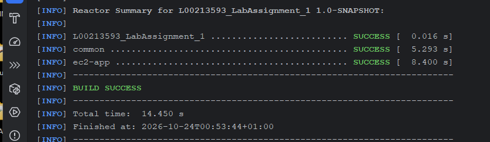

# Development History — Iterations 17–28

[← Project README](../README.md) · [References](REFERENCES.md)

### Iteration 17 — Java Application Reuse for Amazon EC2

**GitHub Pull Request(s):** [PR #12](https://github.com/maxvanny2010/L00213593_LabAssignment_1/pull/12)

#### Step 1 — Extract Shared Java Code into a Common Maven Module

**Objective**

Reuse the existing Java Lambda application logic in a second implementation running on Amazon EC2, without duplicating
the business logic.

**Implementation**

- Created the `common` Maven module.
- Moved `Message`, `MessageService`, `MessageRepository` and `AppConstants` into `common`.
- Added the `common` dependency to `lambda-app`.
- Kept the Lambda-specific `MessageHandler` and `ApiResponse` classes in `lambda-app`.
- Updated the root Maven project to support multiple modules.

**Design Decision**

I decided to reuse the existing application logic instead of developing a second application from scratch.

The shared module contains message validation, UUID generation, timestamps and DynamoDB operations. Both applications
will use this module but expose their functionality through different HTTP mechanisms.

Maven supports multi-module projects and builds dependencies in the required order [[43]](REFERENCES.md#ref-43).

**Validation**

The `common` module compiled and packaged successfully.

The shared classes are now maintained in one location.

#### Step 2 — Create a Lightweight Java HTTP Server

**Objective**

Create a second Java application that can run on Amazon EC2 without Spring Boot or Kubernetes.

**Implementation**

- Created the `ec2-app` Maven module.
- Added a dependency on the existing `common` module.
- Configured Maven Shade Plugin to package the application as an executable JAR.
- Implemented `MessageHttpServer` using the Java HTTP Server API.
- Configured port `8080` as the default HTTP port.
- Implemented `GET /health` for application health checks.

**Design Decision**

I selected the Java HTTP Server API because the application requires only a small number of REST endpoints.

This approach avoids introducing an additional web framework and keeps the implementation focused on AWS infrastructure
and deployment automation.

The EC2 application will reuse the same `MessageService` and `MessageRepository` classes as the Lambda application.

**Testing and Validation**

Executed:

```powershell
mvn -pl ec2-app -am package -DskipTests
```

**Actual Result:** `BUILD SUCCESS`.

Started the HTTP server:

```powershell
java -jar ec2-app/target/ec2-app-1.0-SNAPSHOT.jar
```

**Actual Result:**

```text
Java HTTP Server started on port 8080
```

Tested the health endpoint:

```powershell
curl.exe -i http://localhost:8080/health
```

**Actual Result:**

```http
HTTP/1.1 200 OK
Content-Type: application/json; charset=UTF-8
```

```json
{
  "status": "UP",
  "service": "ec2-app"
}
```

**Result: Passed**

The standalone Java application compiled, started and responded successfully to an HTTP request.

**Limitations**

The EC2 application currently implements only the health endpoint. Message endpoints and DynamoDB integration have not
yet been tested in this application.

The application has been tested locally but has not yet been deployed to Amazon EC2.

**Next Step**

Implement `GET /message` and `POST /message` using the shared `MessageService`, then define the EC2 infrastructure with
AWS CloudFormation.

#### Step 3 — Centralise Jackson Dependency Management

**Objective**
Manage the Jackson JSON library version centrally for both Java applications.

**Implementation**

- Added `jackson-databind` version `2.22.3` to the parent Maven `dependencyManagement`.
- Removed the explicit Jackson version from `lambda-app`.
- Added the Jackson dependency to `ec2-app` without specifying a version.
- Kept the `common` module independent of Jackson because JSON processing belongs to the application entry points.

**Design Decision**
I decided to manage shared dependency versions in the parent Maven project to avoid maintaining the same version in
multiple modules.

Maven `dependencyManagement` provides dependency version management without automatically adding dependencies to every
child module [[58]](REFERENCES.md#ref-58).

**Validation**
Maven compilation and packaging completed successfully for both applications.

**Next Step**
Implement GET and POST message endpoints in the EC2 HTTP server using the shared `MessageService`.

#### Step 4 — Refactor the EC2 HTTP Server

**Objective**

Improve the maintainability of the standalone Java HTTP server by separating application startup, HTTP request handling
and JSON response processing.

**Implementation**

- Simplified `MessageHttpServer` to initialise dependencies and start the HTTP server.
- Created `HealthHandler` for the health endpoint.
- Created `MessageHttpHandler` for GET and POST message operations.
- Created `JsonHttpResponse` for consistent HTTP JSON responses.
- Added `MessageRequest` to represent incoming message data.
- Reused the existing `MessageService` and `MessageRepository` from the `common` module.
- Preserved the existing `/health` endpoint.

**Design Decision**
I decided to separate responsibilities instead of implementing all request processing inside the main server class.

The HTTP handlers manage incoming requests, while the shared service and repository remain responsible for business
logic and database operations.

This approach reduces code duplication and makes the application easier to maintain and test.

The implementation uses the Java HTTP Server API [[57]](REFERENCES.md#ref-57).

**Security Consideration**
The HTTP server listens on localhost by default. The POST endpoint does not implement authentication, so it must not be
exposed publicly without additional protection.

**Dependency Management**
I centralized the SLF4J logging implementation version in the parent Maven POM.
Both `lambda-app` and `ec2-app` declare the `slf4j-simple` dependency without specifying its version.
The `common` module does not depend directly on a specific logging implementation.
This follows the same Maven dependency management approach used for Jackson [[58]](REFERENCES.md#ref-58).

**Testing and Validation**

- Maven packaging completed successfully.
- `GET /health` returned HTTP 200.
- `POST /message` with an empty JSON object returned HTTP 400.
- Invalid message input returned `Message must be a string`.
- SLF4J logging configuration was centralised in the parent POM.

**Result: Passed**
The refactored HTTP server responds correctly to health checks and rejects invalid message requests.
DynamoDB integration testing remains pending until the EC2 instance and its IAM role are deployed.

**Validation**
Maven packaging and local HTTP endpoint checks passed. Valid message read/write operations against DynamoDB from EC2 are
pending until instance deployment and IAM configuration.

**Next Step**
Define the EC2 network with AWS CloudFormation.

### Iteration 18 — EC2 Network Infrastructure

**GitHub Pull Request(s):** [PR #13](https://github.com/maxvanny2010/L00213593_LabAssignment_1/pull/13)

#### Step 1 — Create the VPC Network with CloudFormation

**Objective**
Create a dedicated AWS network for the standalone Java HTTP Server application.

**Implementation**

- Created `infrastructure/ec2/network.yaml`.
- Defined a VPC with CIDR `10.20.0.0/16`.
- Created one public subnet with CIDR `10.20.1.0/24`.
- Used `Fn::Cidr` to calculate subnet address ranges.
- Used `Fn::Select` to select the required subnet and Availability Zone.
- Created and attached an Internet Gateway.
- Configured a public route table with a default IPv4 route.
- Associated the public subnet with its route table.
- Disabled automatic public IPv4 assignment.
- Added resource tags and CloudFormation Outputs.

**Design Decisions**
I decided to create a dedicated VPC instead of using the default AWS VPC.
The application will run on a single EC2 instance and use Amazon DynamoDB as its managed database.
A private subnet and NAT Gateway are not required for the current architecture.
The public subnet uses an Internet Gateway for internet connectivity [[62]](REFERENCES.md#ref-62).

**Subnet Address Allocation**
I used `Fn::Cidr` to calculate two `/24` CIDR blocks from the VPC network:

- Index 0: `10.20.0.0/24`
- Index 1: `10.20.1.0/24`

`Fn::Select` selects index 1 for the public subnet. Only one subnet resource is created [[59]](REFERENCES.md#ref-59).

The Availability Zone is selected dynamically using `Fn::GetAZs` [[61]](REFERENCES.md#ref-61).

**Security**
Automatic public IPv4 assignment is disabled using `MapPublicIpOnLaunch: false`.
The EC2 instance will receive its network access configuration in a later stage.
Security Groups and IAM permissions will be defined separately.

**Testing and Validation**
The CloudFormation template was checked locally:

`cfn-lint --regions eu-west-1 -t infrastructure/ec2/network.yaml`

The command completed with exit code `0`.

**Result: Passed**
Local CloudFormation lint validation passed.
AWS CloudFormation template validation and deployment have not yet been confirmed.

**Next Step**
Add automated CloudFormation validation using GitHub Actions.

### Iteration 19 — Automated CloudFormation Validation

**GitHub Pull Request(s):** [PR #15](https://github.com/maxvanny2010/L00213593_LabAssignment_1/pull/15)

**Objective**
Automate CloudFormation template validation using GitHub Actions and AWS CloudFormation Linter (`cfn-lint`).

**Implementation**

- Created `.github/workflows/cloudformation-lint.yml`.
- Configured the workflow for pushes to `master` and feature branches.
- Enabled automatic validation for Pull Requests targeting `master`.
- Configured Python 3.12 using `actions/setup-python`.
- Added installation of `cfn-lint`.
- Configured validation for `infrastructure/ec2/network.yaml` in the `eu-west-1` Region.
- Restricted workflow permissions to `contents: read`.

**Reference Implementation**
I used the official GitHub `actions/setup-python` workflow example as a starting point [[64]](REFERENCES.md#ref-64).

I adapted its structure to install and execute AWS CloudFormation Linter, following the official AWS
documentation [[60]](REFERENCES.md#ref-60).

GitHub's workflow syntax documentation was used to configure branch triggers, jobs and
permissions [[63]](REFERENCES.md#ref-63).

**My Modifications**

- Selected Python 3.12 for the validation environment.
- Added the installation command `python -m pip install cfn-lint`.
- Added validation for my own EC2 network template.
- Selected the AWS Region `eu-west-1`.
- Configured feature branch and Pull Request triggers.
- Applied read-only repository permissions.

**Design Decision**

I decided to run `cfn-lint` locally before committing and repeat the same validation automatically in GitHub Actions.

This provides an independent check before merging infrastructure changes.

The workflow does not require AWS credentials and does not deploy any AWS resources.

**Testing and Validation**
Local validation:

`cfn-lint --regions eu-west-1 -t infrastructure/ec2/network.yaml`

**Actual Result:** Exit code `0`. No errors or warnings were reported.
GitHub Actions execution: Pending verification.

**Next Step**
Verify the GitHub Actions workflow and proceed with EC2 Security Groups.

### Iteration 20 — EC2 Application Security Group

**GitHub Pull Request(s):
** [PR #16](https://github.com/maxvanny2010/L00213593_LabAssignment_1/pull/16), [PR #19](https://github.com/maxvanny2010/L00213593_LabAssignment_1/pull/19)

**Objective**
Define network access restrictions for the Java HTTP Server running on Amazon EC2.

**Implementation**

- Created `infrastructure/ec2/security-groups.yaml`.
- Defined `ApplicationSecurityGroup` using `AWS::EC2::SecurityGroup`.
- Imported the VPC ID from the network CloudFormation stack.
- Left inbound traffic disabled by default.
- Allowed outbound HTTPS traffic on TCP port 443.
- Added resource tags and a Security Group ID output.

**Reference Implementation**
I used the official AWS CloudFormation Security Group documentation as a reference [[65]](REFERENCES.md#ref-65).
The Security Group references the VPC created in Iteration 18 using `Fn::ImportValue` [[66]](REFERENCES.md#ref-66).

**Design Decisions**
I decided to separate Security Groups from the network template to keep the infrastructure modular.

The Security Group has no inbound rules at this stage. HTTP access to the application will be configured separately
after reviewing access restrictions.

Outbound HTTPS is allowed for connections to AWS services.

**Security Considerations**
Security Groups control network access using protocols, ports and traffic sources.

They do not provide application-level authentication.

**Testing and Validation**

- Local `cfn-lint` validation: pending.
- AWS CloudFormation template validation: pending.
- Infrastructure deployment: pending.

**Next Step**
Review the validation results and prepare IAM permissions for the EC2 application.

### Iteration 21 — EC2 IAM Role and Instance Profile

**GitHub Pull Request(s):
** [PR #17](https://github.com/maxvanny2010/L00213593_LabAssignment_1/pull/17), [PR #20](https://github.com/maxvanny2010/L00213593_LabAssignment_1/pull/20)

**Objective**

Define least-privilege IAM permissions for the EC2 Java application using AWS CloudFormation.

**Implementation**

- Created `infrastructure/ec2/iam.yaml`.
- Defined `ApplicationRole` using `AWS::IAM::Role` with a trust policy for the EC2 service.
- Created a separate `AWS::IAM::ManagedPolicy` granting `dynamodb:Scan` and `dynamodb:PutItem` on the existing messages
  table only.
- Attached the managed policy to the EC2 role.
- Created `ApplicationInstanceProfile` using `AWS::IAM::InstanceProfile`.
- Added CloudFormation Outputs for the IAM role ARN, managed policy ARN and instance profile name.
- Extended GitHub Actions to validate all `infrastructure/ec2/*.yaml` templates.

**Reference Implementation**

I used the official AWS CloudFormation documentation for IAM Roles [[67]](REFERENCES.md#ref-67), Instance
Profiles [[68]](REFERENCES.md#ref-68),
and Managed Policies [[70]](REFERENCES.md#ref-70). AWS documents the use of roles to supply credentials to EC2
applications [[69]](REFERENCES.md#ref-69).

**Design Decision**

I selected an IAM Instance Profile so the Java application can use temporary credentials instead of storing AWS access
keys in source code or configuration.

A separate managed policy keeps permissions independent of the role definition. The permissions are restricted to the
existing DynamoDB messages table. I removed the previously proposed S3 artifact access because the EC2 deployment will
use Docker images built by GitHub Actions and stored in GitHub Container Registry (GHCR), rather than the separate
Lambda artifacts bucket.

The planned deployment uses GitHub Actions, Docker and AWS Systems Manager (SSM). Required SSM permissions and
deployment integration will be added separately when the EC2 deployment is implemented; they are not included in this
IAM template yet.

**Testing and Validation**

- The earlier IAM template passed local `cfn-lint` with exit code `0`.
- The earlier IAM template passed `aws cloudformation validate-template`, which returned `CAPABILITY_IAM`.
- Validation of the revised DynamoDB-only template: pending.
- IAM infrastructure deployment: not performed.

**Next Step**

Validate the revised IAM template, review the Pull Request and prepare infrastructure deployment entirely through
CloudFormation.

### Iteration 22 - IAM Bootstrap and EC2 Network Deployment

**GitHub Pull Request(s):** [PR #18](https://github.com/maxvanny2010/L00213593_LabAssignment_1/pull/18)

**Objective**

Deploy the EC2 network infrastructure using AWS CloudFormation and Infrastructure as Code (IaC).

Configure the required IAM permissions so that the dedicated IAM user `atu-devops-lab`
can deploy and manage the network without using the AWS root account for regular infrastructure operations.

**Initial Problem**

The first attempt to deploy `infrastructure/ec2/network.yaml` using the AWS CLI profile `atu-lab` failed with an
`AccessDenied` error.

The IAM user did not have permission to perform `cloudformation:DescribeStacks` on the `ATU-EC2-Network` stack.

I also attempted to inspect the existing IAM group policies using `iam:ListAttachedGroupPolicies`, but this operation
was denied.

The problem was related to missing IAM permissions, not to the CloudFormation network template.

**Implementation - IAM Bootstrap**

I created a separate CloudFormation template:

`infrastructure/bootstrap/network-deployment-access.yaml`

The template defines an `AWS::IAM::ManagedPolicy` resource named `NetworkDeploymentPolicy`.

The policy is attached to the existing IAM group `ATU-DevOps-Lab-Developers` using
the `Groups` property and the `DeveloperGroupName` parameter.

The existing IAM user `atu-devops-lab` is a member of this group and receives the permissions through group membership.

The bootstrap policy contains the following permission groups:

- `ManageEC2NetworkStack`, allows creating, updating, deleting and inspecting the `ATU-EC2-Network`
  CloudFormation stack and working with CloudFormation Change Sets.
- `ManageNetworkResources`, allows the EC2 networking operations required to create and configure the VPC, subnet,
  Internet Gateway, route table and related resources.
- `ListCloudFormationExports`, allows reading exported values from CloudFormation stacks.

The `AWS::IAM::ManagedPolicy` resource supports attaching managed policies to existing IAM
groups [[74]](REFERENCES.md#ref-74).

**IAM Bootstrap Deployment**

I authenticated to my personal AWS account using a temporary root session with the AWS CLI profile `default`.

The root account was used only to deploy the initial IAM bootstrap because the existing IAM user did not have sufficient
permissions.

Deployment command:

```powershell
aws cloudformation deploy `
  --template-file infrastructure/bootstrap/network-deployment-access.yaml `
  --stack-name ATU-EC2-Bootstrap `
  --capabilities CAPABILITY_IAM `
  --region eu-west-1 `
  --profile default `
  --tags Project=ATU-CloudFormation-Lab ManagedBy=CloudFormation
```

**Actual Result:**

`Successfully created/updated stack - ATU-EC2-Bootstrap`

I verified the CloudFormation stack status using `describe-stacks`.

**Stack Status:** `CREATE_COMPLETE`
The managed policy was created and attached to the existing IAM group.
No networking resources were created by the bootstrap stack.

**Implementation — EC2 Network Deployment**
After updating the IAM permissions, I deployed the existing network template:

`infrastructure/ec2/network.yaml`

The deployment was performed using the dedicated IAM profile `atu-lab`, not the root account.

Deployment command:

```powershell
aws cloudformation deploy `
  --template-file infrastructure/ec2/network.yaml `
  --stack-name ATU-EC2-Network `
  --region eu-west-1 `
  --profile atu-lab `
  --tags Project=ATU-CloudFormation-Lab ManagedBy=CloudFormation
```

**Actual Result:**

`Successfully created/updated stack - ATU-EC2-Network`

The AWS CLI `cloudformation deploy` command creates and executes
CloudFormation Change Sets to apply infrastructure changes [[71]](REFERENCES.md#ref-71).

**CloudFormation Stack Verification**

I checked the network stack status using:

```powershell
aws cloudformation describe-stacks `
  --stack-name ATU-EC2-Network `
  --region eu-west-1 `
  --profile atu-lab `
  --query "Stacks[0].StackStatus" `
  --output text
```

**Actual Result:** `CREATE_COMPLETE`

I then inspected the deployed resources using:

```powershell
aws cloudformation list-stack-resources `
  --stack-name ATU-EC2-Network `
  --region eu-west-1 `
  --profile atu-lab `
  --query "StackResourceSummaries[*].[LogicalResourceId,ResourceType,PhysicalResourceId,ResourceStatus]" `
  --output table
```

All seven CloudFormation resources reached `CREATE_COMPLETE`.

**Verified Network Resources**

| Resource             | Actual Value               |
|----------------------|----------------------------|
| CloudFormation Stack | `ATU-EC2-Network`          |
| VPC ID               | `vpc-06f59f7a44f729242`    |
| VPC CIDR             | `10.20.0.0/16`             |
| Public Subnet ID     | `subnet-081a4368970f2c736` |
| Public Subnet CIDR   | `10.20.1.0/24`             |
| Internet Gateway ID  | `igw-0dafc0da0977c0418`    |
| Route Table ID       | `rtb-0dfd622eba3352dd4`    |
| Default Route        | `0.0.0.0/0`                |

The deployed network includes:

- One VPC.
- One public subnet.
- One Internet Gateway.
- One Internet Gateway attachment.
- One public route table.
- One default route to the Internet Gateway.
- One subnet route table association.

**CloudFormation Outputs Verification**

I retrieved the stack Outputs using:

```powershell
aws cloudformation describe-stacks `
  --stack-name ATU-EC2-Network `
  --region eu-west-1 `
  --profile atu-lab `
  --query "Stacks[0].Outputs" `
  --output table
```

The command returned the VPC ID, subnet ID and their IPv4 CIDR ranges.

CloudFormation Outputs provide resource information without requiring identifiers to be hardcoded into other
templates [[72]](REFERENCES.md#ref-72).

**IAM Permission Troubleshooting — CloudFormation Exports**

After successfully deploying the network, I attempted to list its exported values using `cloudformation:ListExports`.

The first attempt failed with `AccessDenied` because the IAM user `atu-devops-lab` did not have permission to perform
this action.

I updated the existing bootstrap template by adding a separate policy statement:

```yaml
- Sid: ListCloudFormationExports
  Effect: Allow
  Action:
    - cloudformation:ListExports
  Resource: "*"
```

The `Resource: "*"` scope is required because the `ListExports` action does not support resource-level permissions.

I redeployed the existing `ATU-EC2-Bootstrap` stack using the privileged `default` profile.
After the IAM policy update, I repeated the verification with `atu-lab`.

**Actual Result:** The CloudFormation Exports were returned successfully.

**CloudFormation Exports Verification**

command:

```powershell
aws cloudformation list-exports `
  --region eu-west-1 `
  --profile atu-lab `
  --query "Exports[?Name=='ATU-EC2-VpcId' || Name=='ATU-EC2-PublicSubnetId']" `
  --output table
```

**Verified Exports**

| Export Name              | Actual Value               |
|--------------------------|----------------------------|
| `ATU-EC2-VpcId`          | `vpc-06f59f7a44f729242`    |
| `ATU-EC2-PublicSubnetId` | `subnet-081a4368970f2c736` |

These exported values can be imported into subsequent CloudFormation stacks using
`Fn::ImportValue` [[73]](REFERENCES.md#ref-73).

**Design Decisions**
I decided to separate the IAM bootstrap configuration from the network infrastructure.
The bootstrap stack manages deployment permissions, while the network stack manages AWS networking resources.
The AWS root account was used only for the initial IAM bootstrap and its required permission update.
The EC2 network was deployed using the dedicated IAM user `atu-devops-lab`.
This demonstrates the use of identity-based IAM policies to control access to AWS API
operations [[75]](REFERENCES.md#ref-75).

The bootstrap policy restricts CloudFormation stack management to `ATU-EC2-Network`,
although its Change Set ARN pattern covers Change Sets more broadly.

Some EC2 networking actions currently use `Resource: "*"`, which provides broader resource scope than ideal.
The policy should be reviewed for supported resource-level and condition-based restrictions as a future security
improvement.

**Testing and Validation**

- IAM bootstrap deployment: Passed (`CREATE_COMPLETE`).
- EC2 network deployment: Passed (`CREATE_COMPLETE`).
- Bootstrap stack status: Passed.
- Network stack status: Passed.
- Network resource verification: Passed (7 of 7 resources).
- CloudFormation Outputs: Passed.
- CloudFormation Exports: Passed.
- IAM permission update for `ListExports`: Passed.

**Result: Passed**
The IAM bootstrap and EC2 network were deployed and verified using AWS CloudFormation and AWS CLI.
No network resources were manually created in the AWS Console.

**Next Step**
Deploy the EC2 application Security Group using CloudFormation and import the existing VPC ID through `Fn::ImportValue`.

### Iteration 23 — EC2 Security Group Deployment

**GitHub Pull Request(s):** [PR #19](https://github.com/maxvanny2010/L00213593_LabAssignment_1/pull/19)

**Objective**
Deploy the EC2 application Security Group using AWS CloudFormation and verify its network access rules.

**Implementation**

- Reused `infrastructure/ec2/security-groups.yaml`.
- Updated the existing IAM bootstrap template to allow Security Group deployment.
- Added the `ATU-EC2-SecurityGroup` stack to the permitted CloudFormation resources.
- Granted the required EC2 Security Group API permissions.
- Updated the `ATU-EC2-Bootstrap` CloudFormation stack.
- Deployed the application Security Group using the `atu-lab` IAM profile.
- Imported the existing VPC ID using `Fn::ImportValue`.

**Reference Implementation**
The Security Group configuration follows the official AWS CloudFormation documentation [[65]](REFERENCES.md#ref-65).
The deployment reuses the network VPC through a CloudFormation cross-stack reference [[66]](REFERENCES.md#ref-66).
AWS documents the EC2 Security Group permissions required to create groups and manage their
rules [[76]](REFERENCES.md#ref-76).

**Design Decisions**
I decided to deploy the application Security Group as a separate CloudFormation stack.
The Security Group does not allow inbound connections at this stage.
Outbound connections are restricted to TCP port 443 for HTTPS communication.

The Java HTTP Server will listen on port 8080. Inbound application access will be configured separately with appropriate
restrictions.

The IAM bootstrap policy was extended instead of granting AdministratorAccess to the deployment user.

**Testing and Validation**

- Local CloudFormation lint validation: Passed.
- IAM bootstrap stack update: Passed.
- Application Security Group deployment: Passed.
- CloudFormation stack status: CREATE_COMPLETE.
- Security Group ID: Verified through CloudFormation Outputs.
- VPC association: Verified.
- Inbound rules: No inbound rules.
- Outbound rules: TCP 443 to 0.0.0.0/0.

**Result: Passed**
The application Security Group was deployed through CloudFormation without manually creating network resources in the
AWS Console.

**Next Step**
Prepare and deploy the EC2 application IAM Role and Instance Profile.

**IAM Permission Troubleshooting — PassRole**
The initial deployment of `ATU-EC2-IAM` failed because the deployment user `atu-devops-lab` did not have the
`iam:PassRole` permission.

The failure occurred while CloudFormation was configuring the IAM Role and Instance Profile.
AWS CloudFormation rolled back the stack, which reached `ROLLBACK_COMPLETE`.
I updated the existing IAM bootstrap template with a new `PassApplicationRoleToEC2` statement.
The statement grants `iam:PassRole` only for project IAM roles matching `ATU-EC2-IAM-*` and restricts the target service
to `ec2.amazonaws.com`.

I redeployed the `ATU-EC2-Bootstrap` stack through CloudFormation, deleted the failed IAM stack and repeated the
deployment using `atu-lab`.

**Result:** Passed.

### Iteration 25 — EC2 Deployment IAM Permissions

**GitHub Pull Request(s):** [PR #21](https://github.com/maxvanny2010/L00213593_LabAssignment_1/pull/21)

**Objective**
Extend the existing IAM bootstrap policy to allow the `atu-devops-lab` user to deploy and manage an Amazon EC2 instance
using AWS CloudFormation.

**Implementation**
Updated `infrastructure/bootstrap/network-deployment-access.yaml`.
The existing `NetworkDeploymentPolicy` is an AWS IAM Managed Policy attached to the `ATU-DevOps-Lab-Developers` group.
The policy was extended with the following permissions:

**1. CloudFormation Stack Management**
Added the `ATU-EC2-Instance` stack to the permitted CloudFormation resources.
The policy allows creating, updating, describing and deleting the project CloudFormation stack.
The `cloudformation:GetTemplateSummary` action was also added to support subsequent deployments.
AWS CloudFormation uses Change Sets to prepare and execute infrastructure changes [[81]](REFERENCES.md#ref-81).

**2. EC2 Resource Management**
Added the `ManageApplicationEC2Instance` statement.
The statement grants permissions including:

- `ec2:RunInstances`
- `ec2:TerminateInstances`
- `ec2:DescribeInstances`
- `ec2:DescribeInstanceStatus`
- `ec2:DescribeImages`
- `ec2:DescribeNetworkInterfaces`
- `ec2:DescribeVolumes`
- `ec2:CreateTags`
- `ec2:DeleteTags`

The `RunInstances` operation requires permissions for the instance and related resources, including the AMI, network
interfaces, subnet and storage [[82]](REFERENCES.md#ref-82).

**3. IAM Role Assignment**
The existing `PassApplicationRoleToEC2` statement allows the deployment user to pass the project application IAM Role to
the EC2 service.
The permission is restricted to project roles matching `ATU-EC2-IAM-*` and to the `ec2.amazonaws.com` service.
AWS requires `iam:PassRole` when launching an EC2 instance with an IAM Role [[83]](REFERENCES.md#ref-83).

**4. Amazon Linux AMI Parameter**
Added the `ReadAmazonLinuxAmiParameter` statement.
It grants `ssm:GetParameters` for the public Amazon Linux 2023 AMI parameter.
This allows CloudFormation to resolve the AMI ID without hardcoding it in the instance
template [[84]](REFERENCES.md#ref-84).

**5. EC2 Instance State Management**
Added the `ControlApplicationInstanceState` statement.
It allows:

- `ec2:StartInstances`
- `ec2:StopInstances`

The permissions are restricted to the deployed project instance:

`i-050f1033713bc9105`

AWS supports resource-level control for EC2 instance management actions [[82]](REFERENCES.md#ref-82).

**Design Decisions**
I extended the existing CloudFormation-managed IAM policy instead of assigning AdministratorAccess to the deployment
user.
The IAM Role assignment permission is restricted to the application role and EC2 service.
Start and Stop permissions are restricted to the specific application instance.
Some EC2 deployment actions currently use `Resource: "*"`. These permissions should be reviewed and restricted further
before production use.

**Testing and Validation**

- CloudFormation template validation using `cfn-lint`: Passed.
- IAM bootstrap stack deployment: Successful.
- CloudFormation stack: `ATU-EC2-Bootstrap`.
- EC2 deployment permissions: Verified through successful EC2 creation.
- Public AMI parameter access: Verified.
- Instance Stop permission: Verified through a successful `StopInstances` API request.

**Result: Passed**
The deployment IAM user has the permissions required to create and manage the project EC2 infrastructure using AWS
CloudFormation.

**Next Step**
Define and document the EC2 instance infrastructure in a separate CloudFormation template.

### Iteration 26 — EC2 Instance Deployment

**GitHub Pull Request(s):** [PR #22](https://github.com/maxvanny2010/L00213593_LabAssignment_1/pull/22)

**Objective**
Deploy an Amazon EC2 instance using AWS CloudFormation and reuse the network, Security Group and IAM Instance Profile
created in previous iterations.

The purpose of this iteration is to provision the EC2 infrastructure for the Java application. Operating system
configuration and Docker installation will be implemented in later iterations.

**Implementation**
Created `infrastructure/ec2/instance.yaml` using the `AWS::EC2::Instance` CloudFormation
resource [[78]](REFERENCES.md#ref-78).
The template contains two parameters:

- `InstanceType`: Defines the EC2 instance type, with `t3.micro` as the default and `t3.small` as an alternative.
- `LatestAmiId`: Resolves an Amazon Linux 2023 AMI using an AWS Systems Manager public parameter.

The `ApplicationInstance` resource defines the following configuration:

- Instance type: `t3.micro`.
- Operating system: Amazon Linux 2023.
- AMI: Retrieved through the AWS Systems Manager public parameter [[84]](REFERENCES.md#ref-84).
- Network: Existing public subnet imported from `ATU-EC2-Network`.
- Security Group: Existing application Security Group imported from `ATU-EC2-SecurityGroup`.
- IAM: Existing Instance Profile imported from `ATU-EC2-IAM`.
- Public IPv4: Enabled explicitly on the primary network interface [[79]](REFERENCES.md#ref-79).
- Storage: 12 GiB encrypted gp3 EBS root volume [[86]](REFERENCES.md#ref-86).
- Metadata service: IMDSv2 required [[85]](REFERENCES.md#ref-85).
- Resource tags: Name, Project and ManagedBy.
- Outputs: Instance ID, private IP and public IP.

**Design Decisions**

**1. Separate CloudFormation Stack**
I decided to create a separate CloudFormation stack named `ATU-EC2-Instance`.
The network, Security Group and IAM infrastructure are managed by other stacks.
Instead of creating duplicate resources, the EC2 template imports the existing CloudFormation Outputs using
`Fn::ImportValue` [[66]](REFERENCES.md#ref-66).
This allows the EC2 instance to reuse the infrastructure created in previous iterations.

**2. Amazon Linux 2023**
I selected Amazon Linux 2023 for the EC2 instance.
The template uses the following public parameter:

`/aws/service/ami-amazon-linux-latest/al2023-ami-kernel-default-x86_64`

AWS provides public parameters that can be used to retrieve Amazon Linux AMI IDs for the selected
Region [[84]](REFERENCES.md#ref-84).

I selected this approach instead of hardcoding an AMI ID in the CloudFormation template.
The AMI resolved during deployment was:

`ami-058f31f10d44d9317`

**3. Instance Type**
I selected `t3.micro` as the default EC2 instance type.
The application is a small educational project, so I decided to start with a small instance rather than allocate
unnecessary computing resources.
The `InstanceType` CloudFormation parameter also allows `t3.small` to be selected without editing the resource
definition.
AWS CloudFormation supports configuring the instance type through the `InstanceType` property of
`AWS::EC2::Instance` [[78]](REFERENCES.md#ref-78).

**4. Network and Security Group**
The EC2 instance uses the existing public subnet and application Security Group.
The network interface is configured with:

- `DeviceIndex: '0'` for the primary network interface.
- `AssociatePublicIpAddress: true` for public IPv4 assignment.
- `DeleteOnTermination: true` to remove the network interface when the instance is terminated.
- `SubnetId` imported from the network stack.
- `GroupSet` imported from the Security Group stack.

These properties are supported by `AWS::EC2::Instance NetworkInterface` [[79]](REFERENCES.md#ref-79).
The existing public subnet does not assign public IPv4 addresses automatically. Therefore, public IPv4 assignment is
configured explicitly on the instance network interface.
The application Security Group does not allow inbound connections.
Outbound connectivity is restricted to TCP port 443 by the existing Security Group configuration.
This allows the instance to initiate HTTPS connections without opening SSH access.

**5. IAM Instance Profile**
The instance uses the IAM Instance Profile created in the previous IAM infrastructure iteration.
The template imports:

`ATU-EC2-ApplicationInstanceProfileName`

The `IamInstanceProfile` property associates the existing Instance Profile with the EC2
instance [[68]](REFERENCES.md#ref-68).
I selected this approach instead of creating a new IAM Role inside the EC2 instance template.
This keeps IAM resource management separate from EC2 infrastructure deployment.

**6. EBS Storage**
The instance uses an encrypted Amazon EBS root volume.
The `BlockDeviceMappings` configuration defines:

- Device name: `/dev/xvda`.
- Volume size: 12 GiB.
- Volume type: `gp3`.
- Encryption: Enabled.
- Delete on termination: Enabled.

The CloudFormation EBS properties support volume size, type, encryption and lifecycle
configuration [[86]](REFERENCES.md#ref-86).
I selected gp3 storage for this small application server.
The `DeleteOnTermination` setting removes the root EBS volume when the EC2 instance is terminated, helping avoid
retaining unused lab storage.

**7. Instance Metadata Security**
The instance uses:

`HttpEndpoint: enabled`

`HttpTokens: required`

The `HttpTokens: required` setting requires IMDSv2 and disables IMDSv1 access [[85]](REFERENCES.md#ref-85).
I selected this configuration to require session-based requests when accessing EC2 instance metadata.

**8. CloudFormation Outputs**
The template defines three Outputs:

- `InstanceId`: Returns the EC2 instance ID using `!Ref`.
- `PrivateIp`: Returns the private IPv4 address using `!GetAtt`.
- `PublicIp`: Returns the public IPv4 address using `!GetAtt`.

These outputs allow the deployed instance information to be retrieved using the AWS CLI without manually searching the
AWS Console [[78]](REFERENCES.md#ref-78) [[72]](REFERENCES.md#ref-72).

**Deployment**
The EC2 template was validated using `cfn-lint` and AWS CloudFormation.
The instance was deployed using:

```powershell
aws cloudformation deploy `
  --template-file infrastructure/ec2/instance.yaml `
  --stack-name ATU-EC2-Instance `
  --region eu-west-1 `
  --profile atu-lab
```

AWS CloudFormation deployment commands are described in the official AWS CLI documentation [[71]](REFERENCES.md#ref-71).

**Initial Deployment Result**
The deployment completed successfully.
CloudFormation returned:

`Successfully created/updated stack - ATU-EC2-Instance`

The stack reached:

`CREATE_COMPLETE`

**Testing and Verification**
I checked the CloudFormation stack status and EC2 instance information using AWS CLI.
The initial deployment returned the following results:

| Property                            | Actual Result           |
|-------------------------------------|-------------------------|
| AWS Region                          | `eu-west-1`             |
| CloudFormation Stack                | `ATU-EC2-Instance`      |
| Initial Stack Status                | `CREATE_COMPLETE`       |
| Instance ID                         | `i-050f1033713bc9105`   |
| Instance Type                       | `t3.micro`              |
| AMI ID                              | `ami-058f31f10d44d9317` |
| Private IPv4                        | `10.20.1.43`            |
| Public IPv4 at initial verification | `34.242.226.2`          |
| Initial Instance State              | `running`               |

The instance was subsequently stopped using the AWS CLI `ec2:StopInstances` operation.
The StopInstances request was accepted by AWS and returned `stopping`.

**CloudFormation Template Validation**
The CloudFormation template passed the initial validation checks:

- `cfn-lint`: Exit code `0`.
- `aws cloudformation validate-template`: Exit code `0`.

**Result**
The Amazon EC2 instance was successfully provisioned using AWS CloudFormation.
The EC2 infrastructure reuses the existing VPC networking, Security Group and IAM Instance Profile.
The instance configuration includes encrypted EBS storage, IMDSv2 and CloudFormation Outputs for retrieving deployment
information.

**Next Step**
Configure AWS Systems Manager Agent for remote instance management in a separate iteration.

### Iteration 27 — AWS Systems Manager Agent Configuration and CloudFormation Recovery

**GitHub Pull Request(s):** [PR #23](https://github.com/maxvanny2010/L00213593_LabAssignment_1/pull/23)

**Objective**
Configure AWS Systems Manager Agent on the EC2 instance to enable remote management without opening inbound SSH access.
Keep Docker installation for a separate iteration.

**Implementation**
Updated `infrastructure/ec2/instance.yaml` to configure the SSM Agent service through EC2 UserData:

```bash
#!/bin/bash
set -euxo pipefail

systemctl enable --now amazon-ssm-agent
systemctl is-active --quiet amazon-ssm-agent
```

The script enables SSM Agent on boot, starts the service and verifies that it is active. The instance reuses the IAM
Instance Profile created earlier, including the `AmazonSSMManagedInstanceCore` managed policy. AWS describes SSM Agent
setup for Amazon Linux [[80]](REFERENCES.md#ref-80).
In `infrastructure/bootstrap/network-deployment-access.yaml`, the `ManageEC2NetworkStack` statement was extended with
`cloudformation:ContinueUpdateRollback` to support CloudFormation recovery. The `DescribeSSMManagedInstances` statement
was added with `ssm:DescribeInstanceInformation` to allow the deployment user to check managed-instance connectivity.

**Template Validation**

```powershell
cfn-lint --regions eu-west-1 `
  -t infrastructure/ec2/instance.yaml
```

**Actual result:** Passed, exit code `0`.

#### Troubleshooting — EC2 Update Failure and Stack Recovery

**Problem**
The initial CloudFormation update failed while changing the `ApplicationInstance` resource:

```text
UPDATE_FAILED — ApplicationInstance
This instance 'i-050f1033713bc9105' is not in a state from which it can be stopped.
```

The rollback also failed and the stack reached `UPDATE_ROLLBACK_FAILED`.

**Investigation**

An `aws ec2 describe-instances` request showed that the original EC2 instance `i-050f1033713bc9105` was `terminated`.
This instance could not be restarted.

**IAM Permission Fix**
The first rollback-recovery request failed with `AccessDenied` for `cloudformation:ContinueUpdateRollback`. I added this
operation to the existing CloudFormation-managed bootstrap policy and successfully deployed the updated
`ATU-EC2-Bootstrap` stack.

**CloudFormation Recovery**

```powershell
aws cloudformation continue-update-rollback `
  --stack-name ATU-EC2-Instance `
  --resources-to-skip ApplicationInstance `
  --region eu-west-1 `
  --profile atu-lab
```

The skipped resource required reconciliation with the template before continuing deployment. AWS documents recovery from
`UPDATE_ROLLBACK_FAILED`, including resource skipping [[87]](REFERENCES.md#ref-87).
I confirmed recovery with:

```powershell
aws cloudformation describe-stacks `
  --stack-name ATU-EC2-Instance `
  --region eu-west-1 `
  --profile atu-lab `
  --query "Stacks[0].StackStatus" `
  --output text
```

**Actual result:** `UPDATE_ROLLBACK_COMPLETE`.
A check of CloudFormation exports matching `ATU-EC2-Instance` returned no entries. `list-stack-resources` showed a
single resource in the stack: `ApplicationInstance` (`AWS::EC2::Instance`).

#### Replacement EC2 Deployment

I deleted the old `ATU-EC2-Instance` stack and confirmed removal using `aws cloudformation wait stack-delete-complete` (
exit code `0`). This operation did not delete the separate network, Security Group or IAM stacks.
I then deployed the updated instance template:

```powershell
aws cloudformation deploy `
  --template-file infrastructure/ec2/instance.yaml `
  --stack-name ATU-EC2-Instance `
  --region eu-west-1 `
  --profile atu-lab
```

**Actual result:** `Successfully created/updated stack - ATU-EC2-Instance`.
CloudFormation verification returned:

| Property                    | Verified result       |
|-----------------------------|-----------------------|
| Stack                       | `ATU-EC2-Instance`    |
| Stack status                | `CREATE_COMPLETE`     |
| New EC2 instance ID         | `i-0a86cb75e6b6d65b4` |
| Private IPv4                | `10.20.1.205`         |
| Public IPv4 at verification | `3.250.202.78`        |
| AWS Region                  | `eu-west-1`           |

#### SSM Agent Permission and Connectivity Verification

The first call to `ssm:DescribeInstanceInformation` returned `AccessDenied`. I added the following action to the IAM
bootstrap policy:

```yaml
- Sid: DescribeSSMManagedInstances
  Effect: Allow
  Action:
    - ssm:DescribeInstanceInformation
  Resource: "*"
```

The bootstrap stack update succeeded. The first retry still returned `AccessDenied`. After refreshing the `atu-lab`
session using `aws logout` and `aws login`, the request succeeded.

```powershell
aws ssm describe-instance-information `
  --filters "Key=InstanceIds,Values=i-0a86cb75e6b6d65b4" `
  --region eu-west-1 `
  --profile atu-lab `
  --query "InstanceInformationList[*].[InstanceId,PingStatus,AgentVersion]" `
  --output table
```

**Actual results:**

| Check             | Verified result       |
|-------------------|-----------------------|
| EC2 instance ID   | `i-0a86cb75e6b6d65b4` |
| SSM Ping Status   | `Online`              |
| SSM Agent version | `3.3.5390.0`          |

The `Online` result confirms that the replacement instance is registered and communicating with AWS Systems Manager. No
inbound SSH rule was required [[80]](REFERENCES.md#ref-80).

**Result: Passed**
The EC2 stack was recovered, the terminated instance was replaced through CloudFormation, and the replacement instance
was verified as `Online` in AWS Systems Manager. The initial update failure and subsequent IAM access issues were
resolved.

**Next Step**
Install and verify Docker on the EC2 instance in a separate iteration.

### Iteration 28 — Install and Verify Docker Using AWS Systems Manager Run Command

**GitHub Pull Request(s):** [PR #24](https://github.com/maxvanny2010/L00213593_LabAssignment_1/pull/24)

**Objective**

Install Docker Engine on the existing Amazon Linux 2023 EC2 instance and verify that the Docker service is running and
enabled at boot. Use AWS Systems Manager Run Command rather than SSH, avoiding inbound access changes, EC2 replacement
and an EC2 CloudFormation stack update. AWS documents Run Command as a way to execute commands on managed
instances [[89]](REFERENCES.md#ref-89).

**Implementation**

Created `infrastructure/ec2/scripts/install-docker.sh`:

```bash
#!/bin/bash
set -euxo pipefail

dnf install -y docker

systemctl enable --now docker

systemctl is-active --quiet docker

docker info >/dev/null
docker --version
```

Amazon Linux 2023 uses `dnf` for package management [[88]](REFERENCES.md#ref-88). The script installs Docker, enables
and starts the
Docker systemd service, checks its active state, and verifies that the Docker CLI can communicate with Docker Engine.

Updated the `ATU-EC2-Bootstrap` CloudFormation stack through `infrastructure/bootstrap/network-deployment-access.yaml`
to grant the deployment IAM group the permissions needed for this iteration:

- `ssm:SendCommand` on the AWS-managed document `AWS-RunShellScript`.
- `ssm:SendCommand` on the specific EC2 instance `i-0a86cb75e6b6d65b4`.
- `ssm:GetCommandInvocation` and `ssm:ListCommandInvocations` to retrieve command execution results.

Permissions for the SSM document and target instance are scoped separately. AWS documents access controls for Run
Command [[90]](REFERENCES.md#ref-90). The Bootstrap stack update completed successfully.

**Deployment**

The local Bash script was submitted to AWS Systems Manager as the `commands` parameter for the `AWS-RunShellScript`
document. The parameters were stored temporarily in a UTF-8 JSON file without a byte order mark (BOM), supplied using
the AWS CLI `file://` syntax. The temporary JSON file is not part of the committed infrastructure source.

```powershell
$script = [System.IO.File]::ReadAllText(
    (Join-Path (Get-Location) 'infrastructure/ec2/scripts/install-docker.sh')
)

$params = @{ commands = @($script) } | ConvertTo-Json -Depth 3

[System.IO.File]::WriteAllText(
    (Join-Path (Get-Location) 'ssm-docker-parameters.json'),
    $params,
    [System.Text.UTF8Encoding]::new($false)
)

$commandId = aws ssm send-command `
    --instance-ids i-0a86cb75e6b6d65b4 `
    --document-name AWS-RunShellScript `
    --parameters file://ssm-docker-parameters.json `
    --comment 'Install Docker on EC2' `
    --region eu-west-1 `
    --profile atu-lab `
    --query 'Command.CommandId' `
    --output text
```

The first attempt to prepare SSM parameters failed locally because the JSON file contained a UTF-8 BOM and an empty
`commands` array. After populating the Bash script, a second JSON serialization included PowerShell file-provider
metadata; this was corrected by reading the script as a plain string with `[System.IO.File]::ReadAllText()` and writing
the JSON without BOM. Neither of these parameter-format errors resulted in a Docker installation command being run on
EC2.

The valid installation command was accepted by SSM with Command ID `d4648041-0f89-4b18-a4a1-db9c236f5d62`. Its initial
state was `InProgress`, followed by `Success`.

**Verification**

The installation command was checked using `aws ssm get-command-invocation`. Actual results:

| Check                                           | Verified result                        |
|-------------------------------------------------|----------------------------------------|
| AWS Region                                      | `eu-west-1`                            |
| EC2 instance                                    | `i-0a86cb75e6b6d65b4`                  |
| Installation SSM Command ID                     | `d4648041-0f89-4b18-a4a1-db9c236f5d62` |
| Installation status                             | `Success`                              |
| Installation response code                      | `0`                                    |
| Docker package installed                        | `docker-25.0.18-1.amzn2023.0.2`        |
| Docker CLI version reported during installation | `25.0.14`                              |

An independent verification command was then run through SSM using:

```bash
systemctl is-active docker
systemctl is-enabled docker
docker version --format '{{.Server.Version}}'
```

Its actual result was:

```text
Status: Success
ResponseCode: 0
Output:
active
enabled
25.0.18
```

The independent check establishes that Docker Engine version `25.0.18` is running and Docker is enabled to start on
boot. The CLI version reported during installation was `25.0.14`; the server version was verified separately as
`25.0.18`. SSM returned tracing and service messages in `StandardErrorContent` during installation, but the installation
completed successfully with response code `0`.

**Result: Passed**

Docker was installed on the existing EC2 instance using AWS Systems Manager Run Command. Its systemd service is active
and enabled, and the Docker daemon was successfully queried. The EC2 CloudFormation stack was not changed during this
iteration; Docker installation is therefore an operational configuration of the current instance, not yet part of EC2
creation in CloudFormation.

**Next Step**

Use the verified Docker Engine to build and run the application container in a separate iteration.

### Java Application Improvements

**GitHub Pull Request:** [PR #25](https://github.com/maxvanny2010/L00213593_LabAssignment_1/pull/25)

#### Centralised Shared Constants

**Objective**

Improve code consistency and maintainability across the Lambda and EC2 Java applications by centralising configuration
values and reusable constants.

**Implementation**

- Extended `AppConstants.java` in the shared `common` Maven module.
- Centralised HTTP methods, status codes, headers and API routes.
- Added application configuration defaults, JSON field names, error messages, logging messages and request limits.
- Updated `HealthHandler`, `MessageHttpHandler`, `MessageHttpServer` and `JsonHttpResponse` to use shared constants.
- Removed duplicated hardcoded values without changing the existing application logic.

**Design Decision**

I decided to maintain reusable constants in the `common` module because both Java applications depend on it. This
follows the DRY (Don't Repeat Yourself) principle and reduces the risk of inconsistent values across the project.

**Testing and Validation**

Executed:

`mvn clean verify`

**Actual Result:** `BUILD SUCCESS`.

All Maven modules (`common`, `ec2-app` and `lambda-app`) built successfully.

**Maven Build Verification**



The Maven reactor completed successfully, confirming that the shared `common` module and the `ec2-app` application were
built without errors.